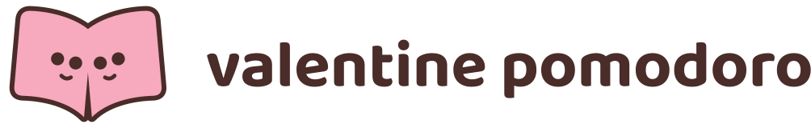
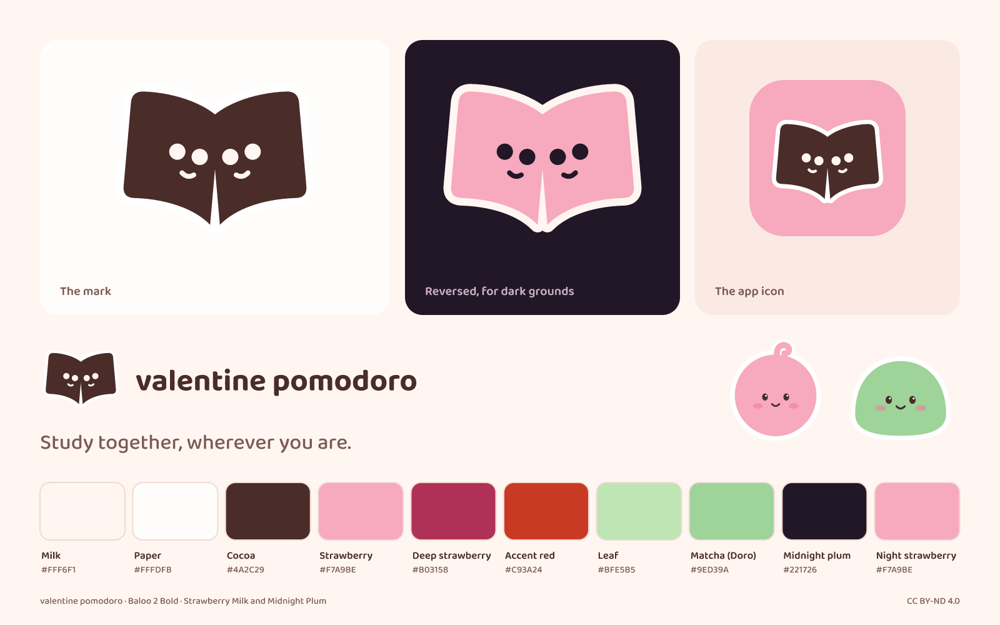
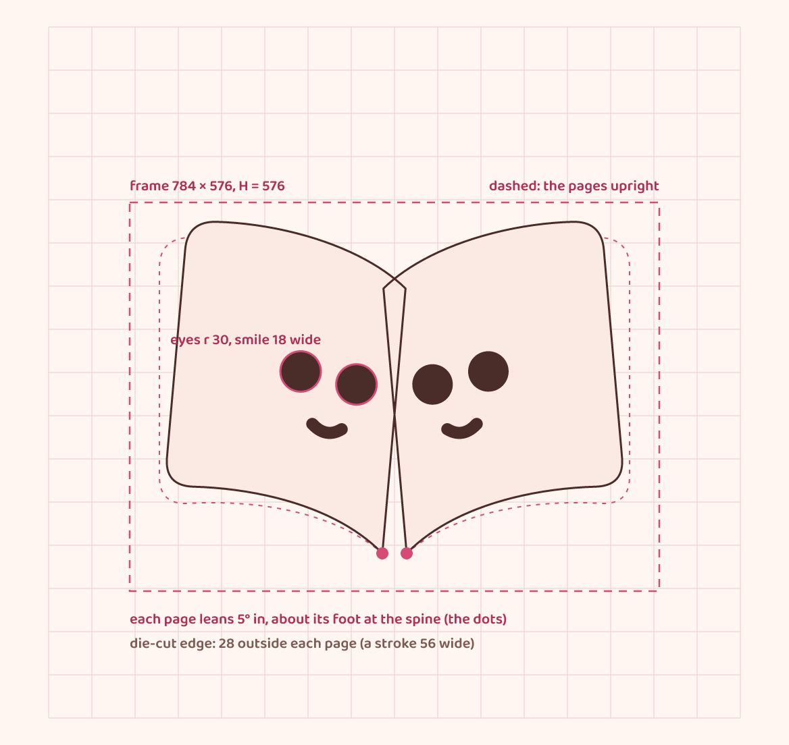
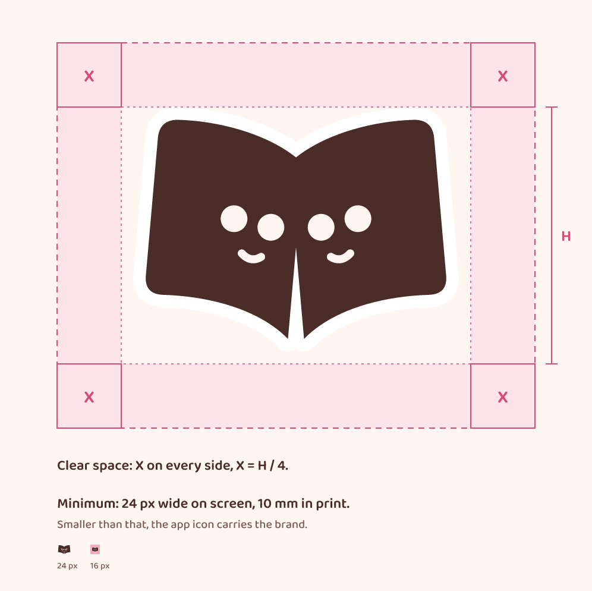
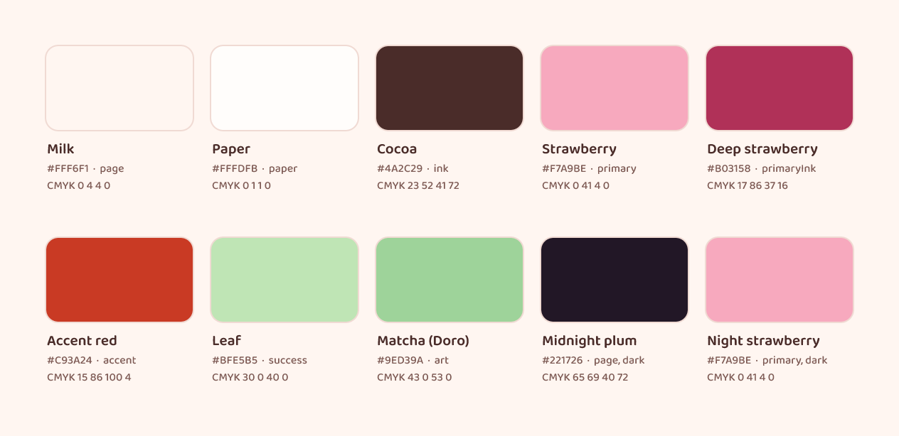
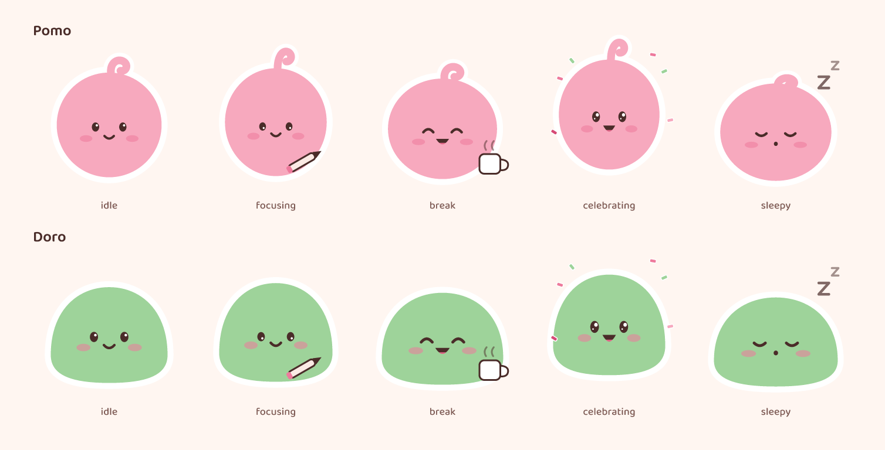
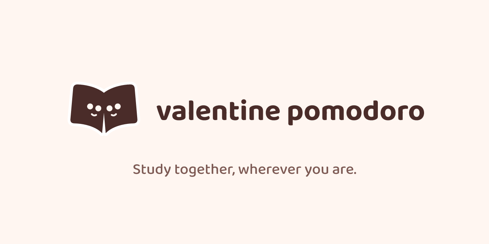

<p align="center">
  <picture>
    <source media="(prefers-color-scheme: dark)" srcset="svg/valentine-pomodoro-horizontal-reversed.svg">
    
  </picture>
</p>

# Valentine Pomodoro brand guide

The identity of Valentine Pomodoro, the study timer for couples: the Same Page mark, its lockups, the colours, the type, Pomo & Doro, and every file in every format. Every asset here is drawn by [`tools/build_brand.py`](tools/build_brand.py) in VectorCraft and checked by [`tools/check_brand.py`](tools/check_brand.py). Edit the numbers in the scripts, not the exported files.



## The idea

Two people who study together, even when they're apart, are **on the same page**. The mark draws that literally: two pages of one open diary, leaning in toward each other, each with a face.

- **The diary** is the app's world. The design direction is "the Sticker Diary": flat, kawaii, die-cut stickers on soft paper, never glass or gradients.
- **The two faces** are the couple. They're the same size and lean in by the same angle; neither is the main one.
- **The die-cut edge** makes the mark a sticker, the one thing in the app that lifts off the page.
- **What it isn't:** no tomato, no clock or ring, no heart, no animal, no plant. Pomodoro timers, study apps and couples apps lean on those already ([ADR-0047](../docs/architecture/adr/0047-same-page-mark-and-the-colon-characters.md)).

**Pomo & Doro** are the mark's companions, not part of it: two small round characters who, together, are the colon in the timer (24**:**59) and, in lettering, the colon between *pomo* and *doro*. See [Characters](#characters).

## The mark

<p>
  
</p>

The mark is drawn on a 1024 grid ([`tools/art_geometry.py`](tools/art_geometry.py)):

- **The pages.** Each page is one closed path, 330 units wide, from the spine out to a rounded outer edge. The top edge curves down into the spine, so the two pages meet in a shallow V.
- **The lean.** Each page is turned 5° toward the other, about its own foot at the spine: (494, 780) for the left page and (530, 780) for the right.
- **The faces.** Two eyes of radius 30 per page, set 84 apart and one 12 lower than the other, so each face tilts toward its partner. Under them, a smile: a quadratic curve, stroked 18 wide with round caps.
- **The edge.** The die-cut edge is each page stroked 56 wide (28 outside the page) with round joins, plus a 64 × 200 block that closes the gap at the spine.
- **The frame.** Place and measure the mark by its frame, 784 × 576 at (120, 260). It holds the mark and its edge. **H** is the frame's height.

**Versions.** The same four as the approved identity sheet (Stage C, C5):

| Version | Pages | Faces | Edge | Use it on | File stem |
|---|---|---|---|---|---|
| **Colour** (default) | Cocoa | Milk | White | Light grounds: milk, paper, white | `valentine-pomodoro-mark-colour` |
| **Reversed** | Strawberry | Midnight plum | Milk | Dark grounds: midnight plum, black | `valentine-pomodoro-mark-reversed` |
| **Single colour, cocoa** | Cocoa | Cut out | None | One-ink print, embroidery, stamps, light grounds | `valentine-pomodoro-mark-single-cocoa` |
| **Single colour, white** | White | Cut out | None | One-ink print and engraving on dark grounds | `valentine-pomodoro-mark-single-white` |

In the single-colour versions the eyes and smiles are real holes (even-odd), so the ground shows through and one ink keeps both faces. On white or milk, the colour version's white edge melts into the ground and the mark reads as cocoa; that is intended.

**There is no small mark.** The faces read down to 24 px and collapse at 16 px. Below the minimum, the app icon carries the brand: the favicons are the app icon, not a stripped-down mark.

## Lockups

| Lockup | Use it for | File stem |
|---|---|---|
| **Horizontal** (primary) | Headers, title slides, documents, the website, the social card | `valentine-pomodoro-horizontal-*` |
| **Stacked** | Square and portrait spaces: posters, covers, profile cards | `valentine-pomodoro-stacked-*` |
| **Mark** | Avatars, stickers, anywhere the name is already said | `valentine-pomodoro-mark-*` |
| **App icon** | The home screen, the favicon, anything under the mark's minimum | `valentine-pomodoro-app-icon-*`, `web/` |

The wordmark is **"valentine pomodoro" in Baloo 2 Bold, lower case**, the lettering style of the identity sheet. Each lockup comes in the mark's four versions; the wordmark is cocoa with the colour and single-cocoa marks, night milk with the reversed mark and white with the single-white mark.

Proportions, in units of the mark's height H:

- **Horizontal.**
  - The wordmark starts 0.24 H after the frame.
  - Its letters are 0.34 H tall (the top of the "l" to the baseline), so its x-height is 0.24 H.
  - That letter band is centred on the frame's middle.
  - Overall 6.27 H wide and 1 H tall.
- **Stacked.**
  - The mark sits on the axis.
  - 0.14 H below the frame, one word per line, centred: letters 0.20 H tall, lines 0.92 em apart.
  - Overall 1.39 H wide (the width of "pomodoro") and 1.68 H tall.

The 1x files set the mark 160 px tall.

### Clear space



Keep at least **X = H / 4** free of other text and graphics on every side, where H is the height of the mark's frame, alone or in a lockup.

### Minimum sizes

| Asset | Screen | Print | Below that |
|---|---|---|---|
| Mark | 24 px wide | 10 mm wide | Use the app icon |
| Horizontal | 160 px wide | 47 mm wide | Use the stacked lockup or the mark |
| Stacked | 60 px wide | 15 mm wide | Use the mark |

The mark's minimum is the C5 test: the smallest width where both faces still read. The lockups' minimums keep the wordmark's x-height at least 6 px on screen and 1.5 mm in print, and the mark at its own minimum (which sets the horizontal lockup's print size).

## Colour



The two free themes of the app, **Strawberry Milk** by day and **Midnight Plum** by night, from [`src/theme/palette.json`](../src/theme/palette.json) (ADR-0045). The core colours, in the identity sheet's order:

| Name | Token | Hex | RGB | CMYK (approx.) |
|---|---|---|---|---|
| **Milk** | `page` | `#FFF6F1` | 255 246 241 | 0 4 4 0 |
| **Paper** | `paper` | `#FFFDFB` | 255 253 251 | 0 1 1 0 |
| **Cocoa** | `ink` | `#4A2C29` | 74 44 41 | 23 52 41 72 |
| **Strawberry** | `primary` | `#F7A9BE` | 247 169 190 | 0 41 4 0 |
| **Deep strawberry** | `primaryInk` | `#B03158` | 176 49 88 | 17 86 37 16 |
| **Accent red** | `accent` | `#C93A24` | 201 58 36 | 15 86 100 4 |
| **Leaf** | `success` | `#BFE5B5` | 191 229 181 | 30 0 40 0 |
| **Matcha** (Doro) | art only | `#9ED39A` | 158 211 154 | 43 0 53 0 |
| **Midnight plum** | `page`, dark | `#221726` | 34 23 38 | 65 69 40 72 |
| **Night strawberry** | `primary`, dark | `#F7A9BE` | 247 169 190 | 0 41 4 0 |

Two more appear in the files: **white** (`#FFFFFF`, the die-cut edge on light grounds) and **night milk** (`#FFF3EE`, `ink` in the dark theme: the reversed wordmark, CMYK 0 6 4 0). The reversed mark's edge is the dark theme's `stickerEdge`, which is milk.

- **Contrast,** WCAG 2.x, computed by [`tools/wcag.py`](tools/wcag.py), the same formula as `src/theme/contrast.ts` (the check proves they agree):
  - the wordmark, cocoa on milk: **11.70:1**; on white 12.47:1
  - the reversed wordmark, night milk on midnight plum: **15.84:1**; white on plum 17.23:1
  - the tagline, cocoa-soft (`inkSoft`, `#7D5A54`) on milk: **5.69:1**
  - strawberry on milk is only 1.73:1, which is why strawberry is a fill under cocoa (6.76:1), never text on a light ground
  - every text pair of the app's two themes is held to its floor by `npm run check:contrast` in CI, and again here
- **CMYK values** are VectorCraft 0.18's conversion with its "Generic CMYK (SWOP-like)" profile, read back from the EPS export. They are approximations: proof them before a print run. No Pantone references are defined yet.
- **Flat fields only.** No gradients, glows or glass.

## Typography

| Typeface | Role | Setting | Licence |
|---|---|---|---|
| **Baloo 2** | The wordmark; the timer, screen titles and sticker captions in the app; the tagline and the guide's labels here | Wordmark Bold (700), lower case; tagline Medium (500), sentence case | SIL Open Font License 1.1 ([`tools/fonts/OFL.txt`](tools/fonts/OFL.txt)) |
| **The system face** (SF Pro on iOS) | Everything else in the app, following Dynamic Type | As the platform sets it | Apple's |

- Every word in these files is an outline. [`tools/wordmark.py`](tools/wordmark.py) shapes the text with HarfBuzz from the committed font, with the font's own kerning and the ligatures off, so "fi" never hides the dot on an i (a Turkish i keeps its dot, ADR-0046). No font needs to be installed to open any file.
- Baloo 2 covers Turkish (ş, ğ, ı, İ, ç, ö, ü), so the app's two languages share one voice.

## Characters



**Pomo** is a round strawberry with one curl. **Doro** is a wide matcha dome. Strawberry and matcha are two flavours of one sweet, so the pair isn't coded by gender, and they differ in silhouette, not in costume ([ADR-0047](../docs/architecture/adr/0047-same-page-mark-and-the-colon-characters.md)).

- **Five poses each:** idle, focusing, break, celebrating and sleepy. No pose sulks or cries.
- **The rendering:** flat fills, the white die-cut edge, cocoa eyes with a white shine, blush cheeks. No outlines, no shading.
- **The single-colour versions** (`pomo-single-colour`, `doro-single-colour`) are one cocoa fill with white features, for one-ink uses.
- **They are not the mark.** Never put a face on the mark's pages other than its own, and never replace the mark with the characters. In the app's signature animation they turn into the two pages and form the mark; the two drawings stay separate.
- **Files:** `svg/` and `png/` (256, 512 and 1024 px) and `source/`. They are the same drawings as the app's `art/src/mascots/`.

## Files

| Folder | Contents | Use for |
|---|---|---|
| `svg/` | The mark (four versions), the horizontal and stacked lockups (four versions each), the app icon (light, dark, tinted), and Pomo & Doro (five poses and a single-colour version each). Text as outlines | Web, apps, slides, anywhere that takes SVG |
| `png/` | The same, transparent except the app icons: marks at 64 to 1024 px wide, lockups at 1x, 2x and 4x, app icons at 1024 px, characters at 256, 512 and 1024 px | Documents and tools that don't take SVG. Use @2x on high-density screens |
| `pdf/` | Marks and lockups in RGB (the palette's sRGB values), one page each, the page the artboard | Print shops, LaTeX (`\includegraphics`), office documents |
| `eps/` | Marks and lockups as CMYK PostScript, no preview, bounding box tight to the art | Older print and sign-making workflows |
| `web/` | `favicon.svg` and `favicon-16/32/48.png`, `app-icon-180/192/512.png`, `avatar-500/1024.png`: all the app icon. `social-card.svg/.png`, 1280 × 640 | Website heads, touch icons, profile pictures, link previews |
| `source/` | The `.vectorcraft` document behind each file in `svg/`, gzip-compressed | Editing in VectorCraft |
| `guide/` | The images in this guide; `brand-board.pdf` is the board as one printable page | This page |
| `tools/` | The build, the check, the shared geometry, the wordmark setter, the contrast formula, and Baloo 2 with its licence | Rebuilding |
| [`LICENSE-BRAND.md`](LICENSE-BRAND.md) | The licence for the brand files: CC BY-ND 4.0 | Read it before using a file outside the project |

**The app icon** (`svg/valentine-pomodoro-app-icon-*`) is the mark as a cocoa sticker on a full-bleed strawberry tile; iOS rounds the corners itself. The dark appearance has strawberry pages on midnight plum; the tinted one is a white mark on black, which iOS tints. They are the app's own icons, drawn by the same code (`art/src/app-icon/`).

**Favicon markup.** VectorCraft does not write `.ico` files. Modern browsers take SVG and PNG:

```html
<link rel="icon" href="/favicon.svg" type="image/svg+xml">
<link rel="icon" href="/favicon-32.png" sizes="32x32" type="image/png">
<link rel="apple-touch-icon" href="/app-icon-180.png">
```

## Don't

The identity sheet's "Never" list, plus the lockups':

- Don't stretch, skew or rotate the mark, or any part of it.
- Don't recolour it outside the palette, or swap the versions' colours (cocoa faces on cocoa pages, a strawberry mark on milk).
- Don't add effects: shadows, glows, gradients, outlines or textures. The die-cut edge is the only edge.
- Don't pull the pages apart, close the V, or change the lean.
- Don't add a heart, a tomato or a clock, and don't put text inside the mark.
- Don't set it on a busy photo without its edge; use a single-colour version on a solid area there.
- Don't retype the wordmark, set it in another face or weight, or capitalise it.
- Don't crowd it: respect the clear space.

## Tagline

> Study together, wherever you are.

The tagline says what the app is for in the words a couple would use. Chosen by the owner on 2026-10-30.

- Set it in Baloo 2 Medium, sentence case, with its full stop.
- Cocoa-soft on milk, or night milk on midnight plum.
- It is not part of any lockup. Keep it at least the clear space X away from the logo.

## Social card



`web/social-card.png` (1280 × 640, the size GitHub and most link previews take) carries the horizontal lockup and the tagline on milk.

## Rebuilding

Requires VectorCraft 0.18 or later (`vectorcraft-cli` on the default install path, or set `VECTORCRAFT_CLI`), Python 3.10 or later with `fontTools` and `uharfbuzz` (`pip install fonttools uharfbuzz`), and Node 22 or later for the contrast cross-check. From the repository root:

```bash
python brand/tools/build_brand.py
python brand/tools/check_brand.py --rebuild
```

The build draws every asset as SVG, runs it headless through VectorCraft (strokes expanded to fills, File Info set, every format exported) and writes `svg/`, `png/`, `pdf/`, `eps/`, `web/`, `guide/` and `source/` in about 20 seconds. `--out DIR` writes the same tree somewhere else. VectorCraft stamps the time and random IDs into PNG, PDF, EPS and `.vectorcraft` files; the build pins each one to a constant of the same length, so two builds give the same bytes.

The check verifies the following and exits non-zero on any failure:

- every expected file exists, and nothing else is in the folders
- the mark, the app icons and the characters are drawn byte for byte as the app's own art sources (`art/src/identity`, `art/src/app-icon`, `art/src/mascots`), so the brand and the app can't drift
- every SVG is well-formed, with a viewBox and its title, no live text, images, scripts, styles or external references, and only its version's colours
- every PNG has its size and colour type (transparent art RGBA, tiles RGB) and no build time
- every EPS paints only in CMYK, only with the values recorded for its version's colours
- every PDF has one page, the artboard's MediaBox and pinned dates; every source has its dates pinned
- the palette and the brand's own pairs meet their contrast floors, and `wcag.py` agrees with `src/theme/contrast.ts`
- with `--rebuild`, a fresh build matches every file byte for byte

**To change the name,** edit `NAME` in `build_brand.py` and rebuild: the wordmark, the file names and every file's metadata follow. Then rename the files' mentions in this guide.

## Notes

- **The name is a working name.** "Valentine Pomodoro" is set in the lockups now, so the brand has a complete kit; the public name is decided before launch (Phase 7). The final wordmark comes then, lettered in the identity sheet's style ("pomo:doro", with Pomo & Doro as the colon), not typeset.
- **Clearance.** A reverse-image search of the mark and a trademark search of the name are the owner's, before launch. This is a note, not legal advice.
- **Usage rights.** The brand files are licensed under CC BY-ND 4.0 ([`LICENSE-BRAND.md`](LICENSE-BRAND.md)): share them unmodified, with credit. Chosen by the owner on 2026-10-30. Baloo 2 is under the SIL Open Font License ([`tools/fonts/OFL.txt`](tools/fonts/OFL.txt)).
- **History.** The decisions are in the Stage C record ([`docs/implementations/2026-10-30-phase1-stage-c-design.md`](../docs/implementations/2026-10-30-phase1-stage-c-design.md), §2.3 to §2.6), [ADR-0045](../docs/architecture/adr/0045-theme-tokens-and-contrast-gate.md), [ADR-0046](../docs/architecture/adr/0046-display-face-baloo-2.md) and [ADR-0047](../docs/architecture/adr/0047-same-page-mark-and-the-colon-characters.md); this kit's record is [`docs/implementations/2026-10-30-brand-kit.md`](../docs/implementations/2026-10-30-brand-kit.md).
