# Architecture

How the app is built today, why, and where the v2 couples rehaul takes it. The structure follows arc42, shortened. Each fact cites a file and line so it can be checked.

**What this describes.** Commit `5b10a78` on `rehaul/v2` (2026-10-29 23:50 +03:00, "feat(b1): load Fly Mode lazily"). **Every `file:line` in this document is a line at that commit**; read it with `git show 5b10a78:<path>`. The working copy already differs. For example, `src/screens/FlyModeScreen.tsx` has 47 changed lines there, so line numbers in the working copy won't match. Work that isn't committed is listed in §1.3 and not described as done.

---

## 1. Introduction and goals

### 1.1 Purpose

Valentine Pomodoro is an Expo React Native focus timer. v1.3.1 is on the iOS App Store, and v1.4.0 is in TestFlight (build 42). It runs entirely on the device: there is no backend and no account. It has two timer experiences:

- **Classic**, a Pomodoro cycle
- **Fly Mode**, which flies a plane between two real airports on a real map, for as long as the flight takes at a 5× speed-up

Around them are a daily goal and streak, love notes, a daily reminder, a first-run gift screen, an update prompt and AdMob ads. What the product must do is in the [SRS](../srs/SRS.md); who it is for is in [`PRODUCT.md`](../../PRODUCT.md).

### 1.2 Quality goals

| # | Goal | Why it ranks here | Requirement |
|---|------|-------------------|-------------|
| Q1 | **The clock is right**: remaining time comes from a stored end timestamp, and every completion is handled exactly once | A study timer that drifts or double-counts is broken | FR-TMR-003, FR-TMR-005 |
| Q2 | **No update loses data** | Existing users, Bengisu included, update in place on the same bundle id | FR-MIG-001, NFR-REL-002 |
| Q3 | **Nothing crashes on a platform gap**: a feature that can't run is hidden | The Android Fly crash loop of 2026-10-29 | FR-FLY-003, NFR-PORT-001 |
| Q4 | **No needless work while a session runs** | Battery and frame rate, multiplied by every future mode | NFR-PERF-003 |
| Q5 | **Minimal network use**, disclosed | There is no backend yet; the few outbound connections are all in §3 | NFR-PRIV-002 |

### 1.3 Work in progress (Phase 1 Stage B), not described as done

> **Update, 2026-10-30 (B6 and B7):** B6 and B7 are merged into `rehaul/v2`: B6 as `1b7a8d7` (`a736b22`, `65fa2ea`, `62fef2e`; [B6 record](../implementations/2026-10-30-phase1-b6-expo-router.md), [ADR-0043](adr/0043-native-tabs-frozen-by-a-wrapper.md)), then B7 as `3d3fbaf` (`6ab3953`…`e0e8f26`; [B7 record](../implementations/2026-10-30-phase1-b7-deferred-startup.md)). Expo Router 58 replaces `src/navigation/`: `index.tsx` imports `expo-router/entry`; `app/_layout.tsx` renders `App` (`src/App.tsx`) around a native stack with `(tabs)` and `+not-found`; `app/(tabs)/_layout.tsx` is the iOS native tab bar. Each tab route renders its screen inside `FreezeOnBlur`, which keeps hidden tabs frozen and lazy. Screens lay out by safe-area insets; the router vendors React Navigation, and the `@react-navigation/*` packages are gone. §5.3 below is current; §5.2 still describes the pre-B6 `App.tsx`. Since B7, `AdManager.init()` and the launch update check wait for the root's first layout (`onLayout={markFirstFrame}` on `App()`'s `GestureHandlerRootView`) and then run in one idle callback (`src/startup/deferredStartup.ts`).

> **Update, 2026-10-30 (B4):** B4 landed, pushed through `178b4ba`, as `b7461f1`, `43cf1a8`, `e9df252`, `040ad32` and `b838ebe` ([B4 record](../implementations/2026-10-30-phase1-b4-rerender-refactor.md)). The F1 chain of §8.1 is gone: the session store has no `tick`, and the engine has no interval. A clock store (`src/stores/clockStore.ts`, `useSyncExternalStore`) samples the wall clock and notifies only when the running slot's displayed second changes. Its scheduler wakes $(r \bmod 1000) + 4$ ms after each sample and also detects completion. Only `<TimerText>` subscribes in the app. The ring's progress is derived on the UI thread from slot SharedValues written in the store's `set()`; Fly's clock SharedValues come from the same hook. Hidden tabs are frozen (`freezeOnBlur`). While a session runs, the Timer screen commits only its `<TimerText>`, once a second. §5, §6.1 and §8.1 below still describe the chain as it was.
>
> **Update, 2026-10-30 (B3):** B3 landed locally as `71d836f`, `ca21ef0`, `7863e50` and `e04cc8c` ([B3 record](../implementations/2026-10-30-phase1-b3-zustand-stores.md)). `AppContext` (§5.4) is deleted: five Zustand stores in `src/stores/` hold the state, hydrated synchronously by `StoreGate`, and every consumer reads them through selectors. The clock's ticker now lives in `useSessionClockEngine`, and `useSessionClock` is a read-only facade. The F1 chain of §8.1 still exists, but only the time displays follow it now. R1, R2, R3 and R5 (§11.2) are fixed. §5 and §8 below still describe `5b10a78`.
>
> **Update, 2026-10-30:** B1b landed as `0d63145` ([B1b record](../implementations/2026-10-29-phase1-b1b-airports-asset.md)) and B2 as `dd1e894` ([B2 record](../implementations/2026-10-29-phase1-b2-mmkv-migration.md)). This document still describes `5b10a78`. Its storage sections (§8.2) describe AsyncStorage as it was before the MMKV migration; the records above describe the change. Re-baseline this document after Stage B.

From `git status` at 2026-10-29 21:16 UTC. Other sessions were changing the working copy while this was written.

- **B1b, `airports.json` out of the bytecode.** Uncommitted: the staged rename `src/assets/data/airports.json` → `airports.jsonasset`; new `metro.config.js`, `src/utils/airportAsset.ts`, `src/utils/airportData.ts`, `src/hooks/useAirports.ts` and two tests; edits to `FlyModeScreen.tsx`, `timerScreenTicks.test.tsx`, `jest.setup.ts` and `package.json` (`expo-file-system`, a `.jsonasset` Jest transform); and the doc `docs/implementations/2026-10-29-phase1-b1b-airports-asset.md`. At HEAD the JSON is still a static import (`FlyModeScreen.tsx:46`).
- **B2, MMKV and the migration.** The [roadmap](../roadmap/ROADMAP.md) marks it in progress. Storage-migration test files appeared in the working copy during this review and were gone again by the 21:16 snapshot, so nothing of B2 is described here.
- **The documentation system.** `docs/srs/`, `docs/roadmap/`, `docs/testing/`, `docs/process/`, `docs/history/`, `docs/README.md`, `CONTRIBUTING.md` and `scripts/docs/`, plus edits to `README.md`, `DECISIONS.md`, `.github/workflows/ci.yml` (a docs-check step) and two plan docs.

---

## 2. Constraints

| Constraint | Detail | Evidence |
|------------|--------|----------|
| **iOS first; Android deferred** | v1.4 ships to iOS only. Android waits for Google Play's closed test (at least 12 testers for 14 consecutive days). | CON-003; [Phase 1 plan](../implementations/2026-10-29-phase1-plan.md) §0, §3b |
| **iOS 16.4 minimum** | Expo's floor from SDK 56 on. iPhone 6s, 7 and the first SE can't install updates. | [SDK 58 upgrade](../implementations/2026-10-29-expo-sdk-58-upgrade.md) §2, §5 finding 4 |
| **Expo SDK 58, React Native 0.88.1, React 19.3.0** | Plus Reanimated 4.7.1 and worklets 0.13.0, Gesture Handler ~3.3.0, react-native-maps 1.29.11, AdMob ^16.5.0 (held on 16 until Phase 5), TypeScript ~6.0.3 in strict mode | CON-001; `package.json:24,38–49,65`; `tsconfig.json` `strict` |
| **The New Architecture** (Fabric, TurboModules), always on | `newArchEnabled` left the config schema in SDK 55, so it can't be switched off. Fabric's legacy-interop layer is where the AIRMap crashes came from (§11). | Upgrade doc §3.2 |
| **Hermes v1** | From SDK 56. Native ships **one** precompiled bytecode bundle: lazy loading defers evaluation but never removes code from the bundle. | Upgrade doc §5 finding 3; Phase 1 plan §5 finding 1 |
| **CNG (generated native projects)** | `/android` and `/ios` are git-ignored and generated from `app.json` by prebuild on EAS. There is no hand-written native code; native changes come only through config plugins and `patch-package`. | `.gitignore:47–49`; `package.json:10` |
| **No Mac** | There is no local iOS simulator or Xcode. Every iOS build goes through EAS Build, and every device check through TestFlight, each with the owner's go-ahead. | CON-004 |
| **Bundle id kept** | `com.bengisu.valentinepomodoro`, so installs update in place | CON-007; `app.json:15,22` |
| **Public repository** | No secrets in the client or the repo; only publishable ids (AdMob) appear in `app.json` | NFR-SEC-002 |
| **OneDrive working copy** | OneDrive can turn files into placeholders that Metro's watcher drops (§11, R4) | Upgrade doc §5 finding 2 |

---

## 3. System context

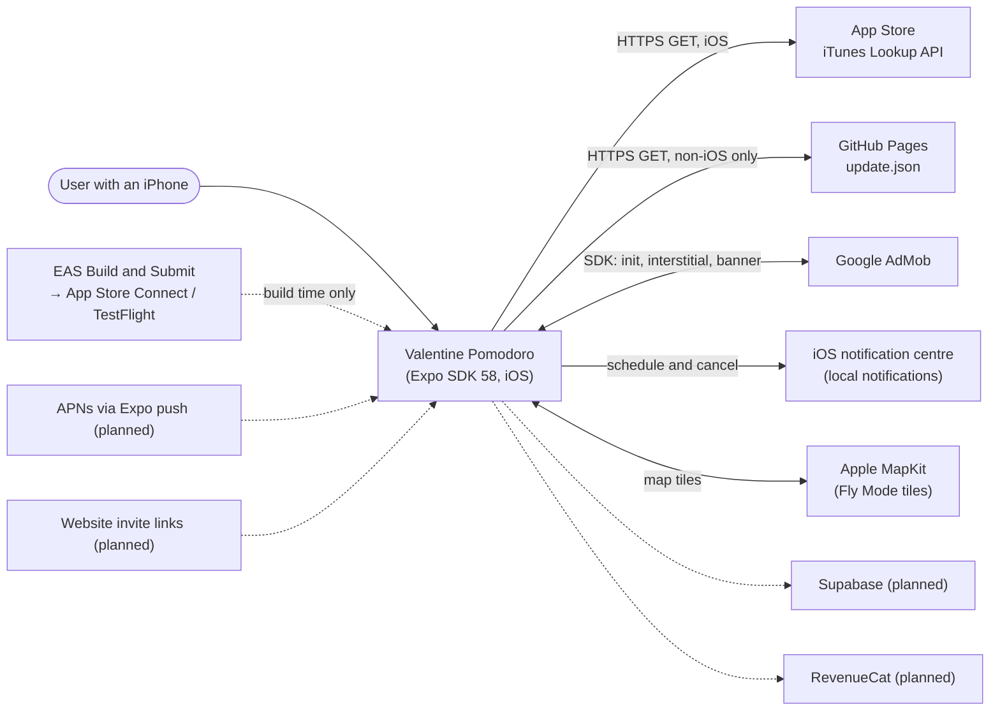

**External systems today**, each checked in code:

| System | What the app does with it | Code | Notes |
|--------|---------------------------|------|-------|
| **App Store, iTunes Lookup API** | **iOS only.** GETs `https://itunes.apple.com/lookup?bundleId=com.bengisu.valentinepomodoro` with a 5 s abort. If `results[0].version` is newer than the installed version, it shows a dismissible alert whose "Update" button opens `trackViewUrl`, falling back to `apps.apple.com/app/id6757491918`. | `src/hooks/useUpdateCheck.ts:23–25,31–39,44–57,79–81,102–113` | Once per cold launch, through a module flag (`:21`). Settings can force a check (`SettingsScreen.tsx:656`). Errors and offline are swallowed (`:82–85`). |
| **GitHub Pages `update.json`** | **Non-iOS only** (Android and web). Reads `latestVersion` and `androidUrl`. | `App.tsx:23`, `SettingsScreen.tsx:24` (the URL is duplicated), `useUpdateCheck.ts:60–66` | Never fetched on iOS. The live file (fetched 2026-10-29 21:15 UTC) says `1.0.2`, while the repo's `docs/update.json` says `1.3.1`, because Pages publishes from `release/ios-1.1.0:/docs` ([documentation-system record](../implementations/2026-10-30-documentation-system.md) §5, finding 1). |
| **Google AdMob** (`react-native-google-mobile-ads` 16.5) | `MobileAds().initialize()` at launch. A preloaded interstitial is shown after a completed session when `AdPolicy` allows it. An anchored adaptive **banner** sits on the Stats screen. Every request is non-personalised. | `src/ads/AdManager.ts:13–25,31–55,63–105`; `StatsScreen.tsx:297–301`; `src/ads/AdConfig.ts:13–25`; `app.json:47–88,105–108` | The iOS ids are real. On Android the app id and interstitial id are Google's **test** ids and the banner id is a placeholder (F3). `__DEV__` builds always use `TestIds`. |
| **Local notifications** (`expo-notifications`) | Asks permission on the first Start. Schedules one date-trigger notification per session end and one daily repeating reminder. A foreground handler shows banners, and tapping a notification opens the Timer tab. | `src/hooks/useNotifications.ts:6–53`; `src/utils/notifications.ts:84–110`; `App.tsx:26–34,52–61` | No network. No push token is created. |
| **Apple MapKit** (`react-native-maps`, Apple provider) | Fly Mode's map: tiles, the `satelliteFlyover` globe, camera moves | `FlyModeScreen.tsx:27,600–602,702–745` | iOS only (§8.6). Loaded only when Fly first opens (B1, §6.5). |
| **EAS Build and Submit** | Builds the native app from git, and submits iOS builds to App Store Connect for TestFlight | `eas.json`; `app.json:101–104` (`projectId`) | Build time only. No runtime calls, since there is no `expo-updates` (§7). |
| Developer website | Settings → "Visit Developer Website" opens it in the browser | `SettingsScreen.tsx:644` | A link, not an API. The `*.vercel.app` host is unreachable from the owner's network ([Phase 0](../implementations/2026-10-29-phase0-foundation.md) §5, finding 1). |

This agrees with [SRS §3.1](../srs/SRS.md#31-external-interfaces).

**Planned v2 additions:**

| System | Purpose | Phase |
|--------|---------|-------|
| Supabase (Postgres, Auth, Realtime, Edge Functions, Storage, pg_cron) | Accounts, pairing, the shared session engine, stats rollups | 2–3 |
| RevenueCat | The couple subscription; its webhook feeds the `entitlements` table | 5 |
| APNs, through Expo push | Server pushes for shared-session ends and partner pause, resume and skip | 3 |
| Website `/invite/[code]`, plus `apple-app-site-association` | Invite links that open the app | 2 and 6 |
| Sentry, and an `events` table | Crashes, plus minimal bucketed analytics | 2 |

---

## 4. Solution strategy

| Problem | Strategy at HEAD | Where |
|---------|------------------|-------|
| Accurate time across backgrounding and kills | **Wall-clock end timestamp.** The clock stores `endAt = Date.now() + duration`. The display is computed as `endAt − Date.now()` at render time, never decremented. | `useSessionClock.ts:190–203,295–301` |
| Two timer experiences that mustn't disturb each other | **One clock with two slots** (`pomodoro`, `fly`) and an `activeKind` pointer. Switching auto-pauses the other slot. | `useSessionClock.ts:242–262` |
| Completion seen by several paths | **An idempotent `fireCompletion`** keyed on the slot's `endAt`, plus a cold-start check on load | `useSessionClock.ts:105–114,134–139` |
| Global state without a library | **One React context** (`AppProvider`) that hosts five hooks, each loading from and saving to AsyncStorage | `src/context/AppContext.tsx:23–57` |
| A smooth plane over a JS-driven map | **A UI-thread worklet** computes progress from the clock every frame, and bridges to the map marker at 15 Hz | `FlyModeScreen.tsx:131,340–370` |
| Native crash classes in react-native-maps | **Two layers**: a native guard (`patch-package`) and a JS `onMapReady` gate | `patches/react-native-maps+1.29.11.patch`; `FlyModeScreen.tsx:207,744,790` |
| Platform gaps | **Feature detection at one point**, `isFlyModeAvailable()`, applied to both stored and requested modes | `src/constants/features.ts:11–22` |
| Refactoring a v1 codebase safely | **Characterization tests and mutation-checked guards before every risky change**: the Phase 0 harness and the Phase 1 Stage A gates | [Test strategy](../testing/TEST-STRATEGY.md) |

---

## 5. Building blocks

### 5.1 Module map

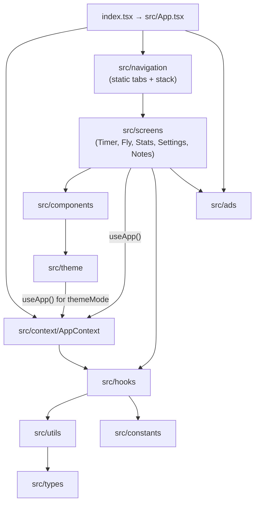

| Folder | Files at HEAD | Role |
|--------|---------------|------|
| (root) | `index.tsx`, `gesture-handler*.tsx`, `src/App.tsx` | Entry, providers, root effects |
| `src/navigation` | `index.tsx`, `screens/NotFound.tsx` | React Navigation 7 static config |
| `src/context` | `AppContext.tsx` | `AppProvider` and `useApp()` |
| `src/hooks` | 11 hooks | State, clock, timer logic, side-effect wrappers |
| `src/screens` | 5 screens | Timer (hosts Classic and Fly), FlyMode, Stats, Settings, LoveNotes |
| `src/components` | 15 files: 13 components, two of them with an `.ios` variant (`ui/`) | Presentational parts; the Fly sheet, pill and picker |
| `src/ads` | `AdConfig`, `AdManager`, `AdPolicy` | AdMob |
| `src/theme` | `tokens.ts`, `useTheme.ts` | Colours and the light/dark resolver |
| `src/utils` | `storage`, `time`, `notifications`, `semver`, `geoMath`, `geoMathWorklet` | Pure functions and thin native wrappers |
| `src/constants` | `defaults.ts`, `features.ts` | Default settings and notes; platform feature flags |
| `src/types` | `index.ts` | Shared types, including the persisted shapes |

### 5.2 Entry and `App.tsx`

- `index.tsx:1–11` imports the gesture-handler shim (native only, `gesture-handler.native.tsx`), then `registerRootComponent(App)`.
- **Module-level side effects in `src/App.tsx`:**
  - Reanimated's logger at `warn`, non-strict (`:1–5`)
  - `Notifications.setNotificationHandler`, which shows banners and the list but plays no sound (`:26–34`)
  - `SplashScreen.preventAutoHideAsync()` (`:36`)
- **Provider order** (`:93–103`): `GestureHandlerRootView` → `SafeAreaProvider` → `AppProvider` → `ThemedApp`.
- **`ThemedApp`** (`:39–91`) is a context consumer through `useTheme()` (`:40`). It runs `useUpdateCheck` (`:45`), calls `AdManager.init()` (since B7, it and the update check defer their work until after the first frame: `src/startup/deferredStartup.ts`), adds the notification-tap listener that navigates to `HomeTabs › Timer` (`:48–64`), renders `Navigation` with the `valentinepomodoro://` prefix (`:71–83`) and shows `GiftModeModal` on first launch (`:86–88`).
- **The splash hides in `onReady`** (`:80–82`): when navigation is ready, not when storage has loaded. So the first frame shows default values until each hook's load resolves.

### 5.3 Navigation

Expo Router 58 (file routes in `app/`; [ADR-0028](adr/0028-expo-router.md), [ADR-0043](adr/0043-native-tabs-frozen-by-a-wrapper.md)).

- **Routes:** `app/_layout.tsx` renders `App` from `src/App.tsx` around a native `Stack` holding `(tabs)` and `+not-found`. `app/(tabs)/` holds `index` (Timer, Classic with the Fly switch), `stats`, `settings` and `notes`. URLs: `/`, `/stats`, `/settings`, `/notes`; the `valentinepomodoro://` scheme maps onto them (FR-NAV-001), and any other path is the 404.
- **The tab bar** is the iOS native one (`expo-router/native-tabs`, a `UITabBarController`), with SF Symbols typed against `IconSymbol`'s mapping. No switch animation. Its `tabPress` listener plays the haptic when Haptics is on (`tabPressHaptic.ts`, DEF-007).
- **Frozen, lazy tabs:** native tabs mount every tab at launch and never freeze, so each tab route renders its screen inside `FreezeOnBlur` (react-freeze, keyed on `useIsFocused`). A hidden tab stays mounted and keeps its effects; it renders nothing until shown again, and a tab never opened is never rendered.
- **Safe areas:** each tab has its own `SafeAreaProvider` whose bottom inset includes the bar. Timer pads by it; Stats, Settings and Notes rely on their `SafeAreaView`; the Fly sheet reads the window's inset through `useWindowInsets()`. Every tab sets `disableAutomaticContentInsets`.
- **One copy of React Navigation:** the router vendors it. `useSlotClock` reads `NavigationContext` from `expo-router/react-navigation`; nothing imports `@react-navigation/*`.
- **The splash** stays up until `ThemedApp` (below `StoreGate`) has mounted; the router's own hide is blocked by the public `preventAutoHideAsync()`.

### 5.4 `AppContext`

**Contract** (`src/context/AppContext.tsx`):

- **Inputs:** none. It must be mounted exactly once, above every screen.
- **Outputs:** `useApp()` returns `{ settings, stats, loveNotes, reminder, activeMode, setActiveMode, session }`. Each value is the return of one hook instantiated once, at `:25–29`. Outside the provider, `useApp()` throws (`:59–63`).
- **Side effects:** loads `app_mode` once (`:35–37`). `setActiveMode` passes the mode through `resolveAppMode`, then saves it (`:39–43`).
- **Invariant:** `activeMode` is never `'fly'` where Fly is unavailable (FR-FLY-003). It is resolved both on read and on write.
- **Memoisation:** the `useMemo` at `:46–50` lists every hook's return value as a dependency. Each hook returns a fresh object literal on every render, so on any `AppProvider` render the value's identity changes. This is the chain in §8.1.

### 5.5 Hooks

#### `useSessionClock`: the shared wall clock

`src/hooks/useSessionClock.ts`. It must be instantiated exactly once, inside `AppProvider`; a `__DEV__` counter logs an error otherwise (`:26,118–123`).

**Public interface** (`:34–55`):

| Member | Meaning |
|--------|---------|
| `state: SessionClockState` | `{ activeKind, pomodoro, fly }`. Each slot is a `SessionSlot` or `null` (`src/types/index.ts:103–127`). |
| `displayMs` | Remaining ms of the **active** slot, computed at render (`:295–301`). Running: `max(0, endAt − now)`. Paused: `pausedRemainingMs`. No slot: `0`. |
| `endAtSV`, `durationSV`, `isRunningSV`, `progressSV`, `elapsedSV` | Reanimated SharedValues mirroring the active slot (`:72–94`). **No screen reads them at HEAD** (§11, R13). |
| `start({ kind, durationMs, extras })` | New slot: `endAt = now + durationMs`, `sessionStartedAt = now`, `sessionId = "<now>-<random>"`, merged with `extras`. Makes `kind` active (`:190–203`). |
| `pause()` / `resume()` | Active slot only. Pause stores `pausedRemainingMs = max(0, endAt − now)` and nulls `endAt`; resume sets `endAt = now + pausedRemainingMs`. Each is a no-op in the wrong state (`:205–233`). |
| `stop()` | Clears the active slot and `activeKind` without firing completion (`:235–240`) |
| `switchTo(kind)` | Auto-pauses a running slot of the *other* kind, then sets `activeKind = kind` (`:242–262`) |
| `extend(ms)` | Adds to `endAt` and `durationMs` of a running active slot (`:264–280`). **Has no caller at HEAD.** |
| `setSlotExtras(kind, extras)` | Merges non-clock fields, such as `scheduledNotificationId` (`:282–287`) |
| `onComplete(handler)` | Registers `(slot, kind) => void` in a `Set` and returns an unsubscribe function (`:289–292`) |

**Contract:**

- **Every mutation goes through `commit`** (`:97–102`). Commit sets React state, writes `clockStateRef` synchronously, saves `session_clock` (fire-and-forget; errors swallowed) and re-syncs the SharedValues.
- **Idempotent completion** (`:105–114`, FR-TMR-005). `fireCompletion(slot, kind)` proceeds only if the live slot for `kind` still has the same `endAt` (`:109`). It clears that slot and `activeKind`, commits, then calls every handler synchronously. A second detector that arrives later finds `null` or a different `endAt`, and returns.
- **Cold-start check** (`:117–150`). On mount it loads `session_clock` (the idle state if missing or corrupt). If the active slot is running with `endAt ≤ now`, it commits the cleared state and calls the handlers once (`:134–139`); otherwise it commits the loaded state. A `cancelled` flag guards against unmount. Only the *active* slot is checked; the other can't be running, because `switchTo` pauses it.
- **1 Hz ticker** (`:153–168`). It reads `clockStateRef` (never stale state). With no running active slot it does nothing. Past `endAt` it calls `fireCompletion`; otherwise `setDisplayTick(t => t + 1)` (`:164`), **the only reason screens re-render each second** (§8.1).
- **AppState listener** (`:171–186`). It handles only `'active'`: past `endAt` it calls `fireCompletion`, otherwise it re-syncs the SharedValues. Backgrounding itself is not handled; the OS notification covers it.
- **Time basis:** `Date.now()` everywhere, the same clock `expo-notifications` schedules against (`:12–14`). `setInterval` and `AppState.addEventListener` appear nowhere else in `src/` (checked with `git grep`).

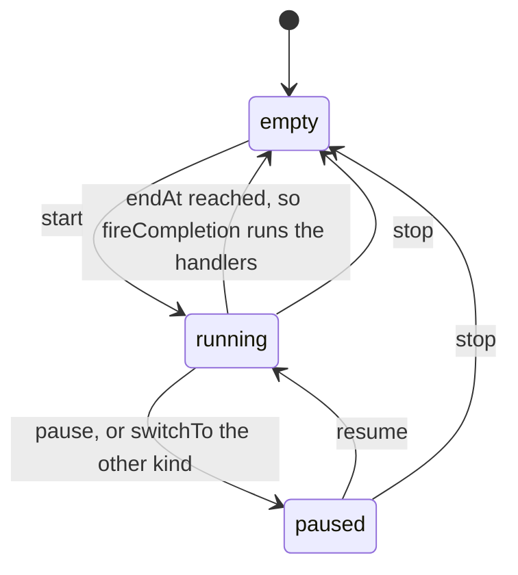

#### `useTimer`: the Pomodoro layer over the clock

`src/hooks/useTimer.ts`. It is called once, by `TimerScreen` (`TimerScreen.tsx:60–69`), with `settings`, `pickRandomNote`, an `incrementFocus` wrapper and `session`.

- **Own state:** `PomodoroState { phase, completedFocusCountInCycle, lastLoveNote }` (`:14–18`), loaded from `timer_state` and saved on every change. Legacy v1.0 clock fields in that key are ignored (`:62–80`).
- **Phase state machine** (pure; exported for tests; `:270–293`):

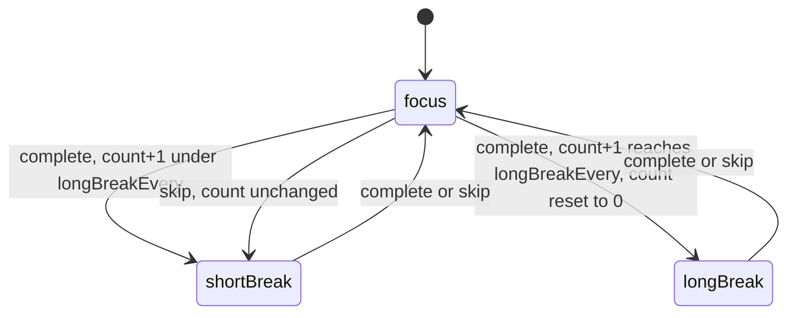

  A skipped focus never counts toward the long break; Phase 0 pinned this behaviour as a characterization (FR-TMR-001, FR-TMR-002). The next phase is set but not started; the user presses Start again.
- **Actions.** `start` schedules the end notification (raced against 1 s), then calls `session.start` with extras `phase`, `completedFocusCountInCycle`, `sessionPlannedMinutes` (the duration at start, FR-TMR-007) and `scheduledNotificationId` (`:154–182`). `pause`, `resume`, `skip` and `reset` each cancel or reschedule exactly the slot's notification (`:184–232`, §6.3).
- **Completion** (`:101–141`, only for `kind === 'pomodoro'`). On a focus phase, it credits `sessionPlannedMinutes` to the day the session **started**, with its `sessionId` (`:108–113`). Then it computes the next phase, picks a love note and fires a success haptic (each when its setting is on), persists the Pomodoro state and shows the note card.
- **`remainingMs`** is derived at render: the running slot's `endAt − now`, else `pausedRemainingMs`, else the full duration of the current phase (`:243–249`).

#### `useStats`: the per-day map, goal and streak

`src/hooks/useStats.ts`.

- **State:** `StatsState { days: Record<'YYYY-MM-DD', DayStats>, goalMinutes, streak, lastAppliedSessionId? }` (`src/types/index.ts:59–83`). The default goal is 50 (`:6`).
- **Load** (`:106–155`). `stats_v2` is used if it passes `isV2`; otherwise the v1 `stats` map is migrated with goal 50 and an empty streak (`stats` is never written or deleted). Loaded days are **added** to any in-memory days, so a completion that lands before the load finishes isn't lost (`mergeDays`, `:40–47`). `isReady` becomes true in `finally`.
- **`incrementFocus(minutes, dayKey?, sessionId?)`** (`:170–262`):
  - **Idempotency:** returns unchanged if `sessionId === lastAppliedSessionId` (`:177–182`, FR-STA-002). It remembers a single id, not a set.
  - The day's goal is snapshotted on its first touch (`:189`); a hit is `dayGoal > 0 && minutes ≥ dayGoal` (`:195`).
  - **The streak changes only on the first hit of a day:** `current + 1` if "yesterday" was a hit day, else 1, and `best = max(best, current)` (`:210–234`). A `celebrationTrigger` becomes `goalHitPulse` for the goal popup (`:98–104`).
- **Read-time streak rule:** `normalizeStreakForToday` zeroes `current` when the last hit was 2 or more days ago (`:53–62,298–300`, FR-STA-005).
- **Persistence:** a save-version counter plus a promise chain serialises writes, and nothing is written before `isReady` (`:83–95`).
- **Outputs:** `stats` (the day map), `isReady`, `incrementFocus`, `today`, `totals`, `last7Days`, `goalMinutes`, `setGoalMinutes` (clamped 0–1440), `streak`, `goalHitPulse` and `clearGoalHitPulse` (`:302–319`).
- **Known gaps** (§11, R1–R3): `lastAppliedSessionId` isn't carried through a load; "yesterday" comes from the real date, not from the credited day; Fly credits bypass both the id and the start day.

#### The other hooks

| Hook | Contract (inputs → outputs; side effects) | Lines |
|------|---------------------------------------------|-------|
| `useSettings` | → `{ settings, isReady, updateSettings(partial) }`. Loads `settings` and deep-merges it with `DEFAULT_SETTINGS`, `durations` included. `updateSettings` saves **inside the state updater** and doesn't use the hook's own `enqueueSave` chain, so the "serialize writes" comment (`:10`) doesn't hold for updates. | `useSettings.ts:6–71` |
| `useLoveNotes` | → `{ notes, count, isReady, addNote, editNote, deleteNote, resetToDefaults, pickRandomNote }`. Notes are trimmed with whitespace collapsed, and exact duplicates are dropped. A stored empty array falls back to the defaults (`:31`). The anti-repeat pick takes the next index (FR-NTE-001). | `useLoveNotes.ts:10–112` |
| `useReminder` | → `{ reminder, isReady, enableDailyReminder, disableDailyReminder, setReminderTimeHHMM, setQuietHours }`. Schedules a DAILY calendar trigger, moved out of quiet hours (FR-NTF-002). Reschedules when the time or the quiet hours change while enabled. A scheduling failure leaves it disabled. Off on web. | `useReminder.ts:19–194`; `utils/notifications.ts:19–110` |
| `useNotifications` | → `{ ensurePermissions, scheduleSessionEnd(endAtMs, title, body), cancelScheduled(id) }`. Asks permission on first use and creates the Android channel `timer`. Returns `null` for an end within 250 ms or when permission is denied. Cancel ignores ids that are gone. | `useNotifications.ts:5–56` |
| `useUpdateCheck` | `(updateJsonUrl)` → `{ checkForUpdates({ force? }) }`. Runs once per process, after the first frame (B7; §3). | `useUpdateCheck.ts:68–123` |
| `useGiftMode` | → `{ hasSeenGiftMode, isReady, dismiss }`. Defaults to "seen" until loaded, so the modal doesn't flash. | `useGiftMode.ts:5–37` |
| `useFlyModeAudio` | `(soundKey, active, enabled)`. Loops `fly-ambient.m4a` while both flags are true. Sets the audio mode so it plays in silent mode and mixes with other audio. Releases the player on unmount. | `useFlyModeAudio.ts:39–83` |
| `useResponsive` | → `{ width, height, isLandscape, isTablet (narrow side ≥ 600), isShortViewport (height < 500) }` | `useResponsive.ts:16–25` |

### 5.6 Screens

| Screen | Responsibility | Key facts |
|--------|----------------|-----------|
| `TimerScreen` | Hosts **both** modes. Classic: ring, phase chip, Start/Pause/Resume, Skip, Reset with a confirm, and the overlay queue: goal popup, then love note, then interstitial (`:104–147`). Fly: `FlyModeScreen` behind `lazy` + `Suspense`, with `ModeSwitcher` outside the boundary (`:25,346–357`). | Mirrors `activeMode` into `session.switchTo` (`:86–95`). The ring's progress is React state, `1 − remainingMs/totalMs` (`:174–177`). The switcher is hidden where Fly is unavailable (`:376–378`). |
| `FlyModeScreen` | Airport pick (picker, or a map tap picks the nearest airport), a great-circle route of 100 waypoints, the plane worklet, three camera modes, the globe toggle, the sheet and pill, ambient audio, the landing note and ad | 1,207 lines. `AIRPORTS` is built from the static JSON at module evaluation (`:46,69–71`). Its own fly-slot SharedValues (`:262–264,321–331`), so the plane never follows the Pomodoro slot. |
| `StatsScreen` | Today, all-time, a 7-day chart (sessions or minutes), the streak, the banner ad | The loading return comes after every hook (`:83–84`, FR-STA-006) |
| `SettingsScreen` | Durations (focus 1–180, short 1–60, long 1–120, long-break-every 2–10), toggles, theme, goal presets 25/50/75/100, reminder and quiet-hours pickers, update check, About | `:25,51–86` |
| `LoveNotesScreen` | Note CRUD | `KeyboardAvoidingView` (`:133`) |

### 5.7 Components

- **Fly:** `FlySheet` (two snap points; Gesture Handler 3's deprecated `Gesture.*` builders; writes `sheetProgress`), `FlyTimerPill`, `AirportPicker`.
- **Classic:** `CircularProgress` (SVG ring), `CalmBackground` → `PremiumCalmBackground` (animated gradients; static when Reduce Motion is on), `GoalReachedPopup` and `LoveNoteCard` (RN `Animated`).
- **Shared:** `ModeSwitcher`, `GiftModeModal`, `HapticTab`, `ui/IconSymbol` (SF Symbols on iOS; a Material mapping elsewhere, checked with `satisfies`), and `ui/TabBarBackground` (an iOS `BlurView`).

### 5.8 Ads

**`AdPolicy`** (`src/ads/AdPolicy.ts`), a module singleton:

- **State:** `AdState { sessionsSinceLastAd, lastShownAt }` (`:8–11`), persisted as `ad_policy_v1` **directly through AsyncStorage, bypassing `storage.ts`** (`:3,30,90`).
- **Operations:** `init()` loads it once over the defaults, keeping the defaults on failure (`:27–39`). `recordSessionCompletion()` increments and persists (`:45–54`). `recordAdShown()` resets the counter and stamps the time (`:81–86`).
- **`shouldShowAd()`** returns `sessionsSinceLastAd ≥ 2 ∧ now − lastShownAt ≥ 120 s`, and `false` before `init` has finished (`:62–75`).
- **Invariant:** at most one interstitial per 2 completed sessions and per 120 s, across restarts.
- **Callers:** Classic counts only *focus* completions, inside the `incrementFocus` wrapper (`TimerScreen.tsx:64–67,75–80`). Fly counts every landing (`FlyModeScreen.tsx:401–403`). The Stats **banner is outside the policy** (§11, R4).

**`AdManager`** (`src/ads/AdManager.ts`). `init()` initialises the SDK, then the policy, then preloads (`:13–25`); `preload()` is a no-op while an ad is loaded or loading (`:31–55`). `showIfReady(onClose)` checks the policy, then whether an ad is loaded, then shows it; `recordAdShown` runs on `CLOSED` and the next preload follows 1 s later, and every skip path calls `onClose` (`:63–105`).

**`AdConfig`** reads the ids from `app.json` `extra`, and uses `TestIds` in `__DEV__` or when an id is missing (`:5–25`).

### 5.9 Theme

- `useTheme()` resolves `settings.themeMode` (`system | light | dark`) against `useColorScheme()` and returns `{ colors: LightTheme | DarkTheme, isDark }` (`src/theme/useTheme.ts:10–30`).
- `tokens.ts` holds the two palettes, including the lilac and violet aurora gradients (`:6–42`), and `ValentineSpec`, Fly's fixed palette (`:49–55`).
- **`useTheme` calls `useApp()`, so every component that themes itself is a context consumer** (§8.1).

### 5.10 Utilities

| Module | Contract |
|--------|----------|
| `storage.ts` | `save(key, value)`: JSON-stringifies, logs and **rethrows** on failure. `load(key, default)`: returns `default` when the key is missing or the JSON is corrupt, and logs. `remove(key)`. `STORAGE_KEYS` (`:6–61`). |
| `time.ts` | `formatTime(ms)` → `MM:SS` with `⌊ms/1000⌋`. `getTodayKey` and `getDayKeyFromDate` build local `YYYY-MM-DD` keys. `diffDays(a, b)` is DST-safe through UTC midnights (`:4–56`). |
| `notifications.ts` | Quiet-hours maths (crosses midnight), the daily-reminder schedule, the `daily-reminder` Android channel (`:19–110`) |
| `geoMath.ts` | Haversine distance; `flightDurationToSeconds` (÷5, clamped to [5, 180] min, an effective floor of 9 min); great-circle waypoints; nearest airport; `interpolateAlongPath`; `calculateBearing` |
| `geoMathWorklet.ts` | `interpolateAlongPathWorklet`, the UI-thread twin, defined at module scope for the worklets plugin. Its equality with the JS version is enforced by `geoMath.equivalence.test.ts` (FR-FLY-002), not by comments (`:1–55`). |
| `semver.ts` | `compareSemver(a, b)` → −1, 0 or 1 over numeric parts (`:6–18`) |

### 5.11 Constants and types

- `constants/defaults.ts`: `DEFAULT_SETTINGS` (25/5/15, every 4, everything on, `system` theme) and the 20 default love notes, which still carry Bengisu's name; D2 replaces them for fresh installs (FR-NTE-002).
- `constants/features.ts`: `isFlyModeAvailable(os) = os === 'ios'` and `resolveAppMode` (`:11–22`).
- `types/index.ts`: the persisted shapes (§8.2) and the clock types (`:103–127`). It has **two stale declarations:** `TimerState` (`:8–24`) is the v1.0 `timer_state` shape, which is no longer written, and `LoveNotes { notes }` (`:91–93`) doesn't match the bare array that is actually stored. The A3 fixture records both (`src/__fixtures__/storage/v131.ts:66–83`).

---

## 6. Runtime views

### 6.1 Start → tick → complete, in Classic

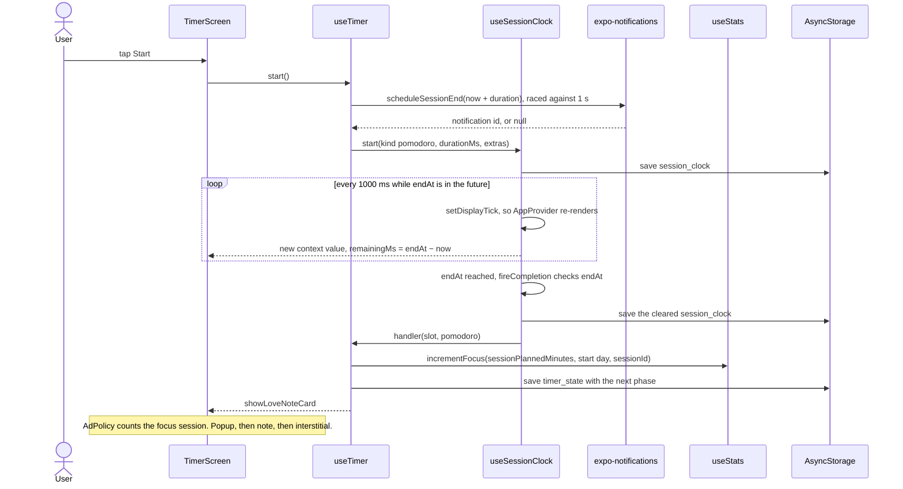

### 6.2 Completion while backgrounded or killed

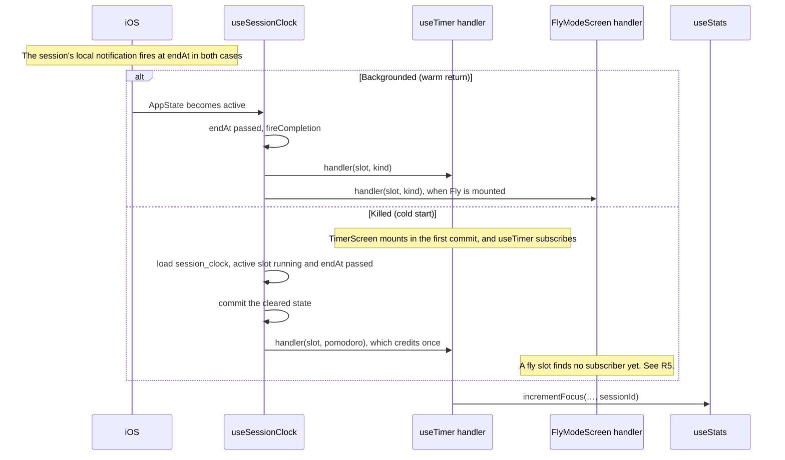

Both paths, and their race with the 1 Hz ticker, end in the same `endAt` guard, so a slot completes at most once. `useSessionClock.test.ts:73–116` covers the warm race and the cold start for Pomodoro. On a cold start the fly handler most likely isn't subscribed yet. `FlyModeScreen` mounts only after `app_mode` has loaded (`AppContext.tsx:35–37`) and the lazy import has resolved (§6.5). The clock's load was started earlier, at `useSessionClock.ts:127`, and fires its handlers synchronously when it resolves (`:134–139`). So a flight that lands while the app is dead is cleared without credit. This comes from reading the code; it hasn't been tested on a device, and no test covers it (§11, R5).

### 6.3 Notification scheduling and cancellation

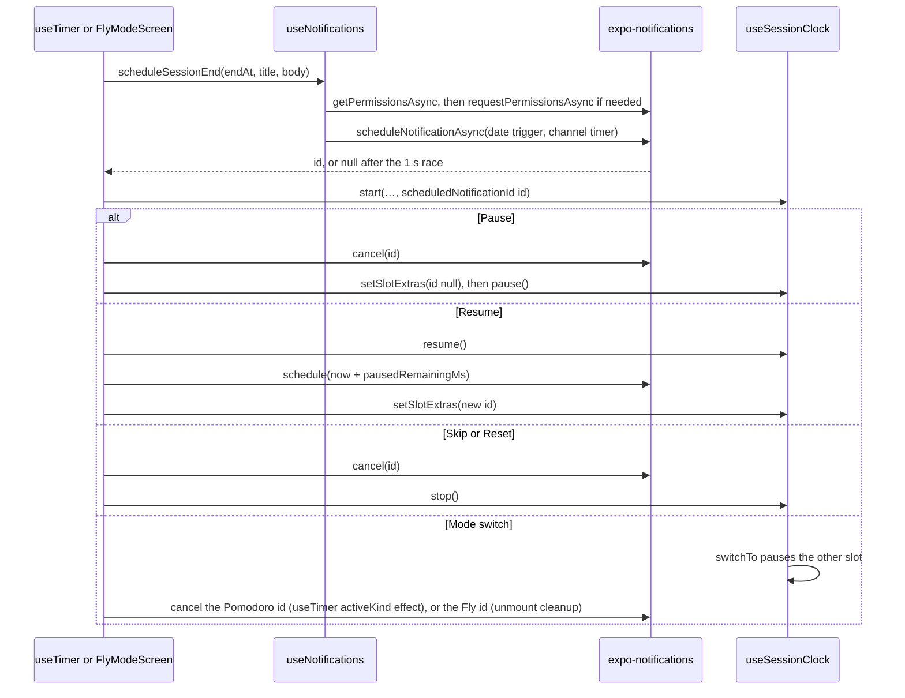

- Code: `useTimer.ts:85–98,154–232`; `FlyModeScreen.tsx:373–376,408–495,586–591`.
- **Completion doesn't cancel** anything, because the notification is the completion alert. In the foreground it shows as a banner (`App.tsx:26–34`).
- **The daily reminder** is separate: a DAILY trigger with its own id in `reminder_v1`, cancelled and rescheduled when its settings change (`useReminder.ts:110–160`).
- **Known hole** (FR-NTF-001): if scheduling takes longer than the 1 s race, the id is dropped, but the notification is still scheduled, and nothing can cancel it (§11, R6).

### 6.4 Fly Mode plane animation (UI-thread worklet)

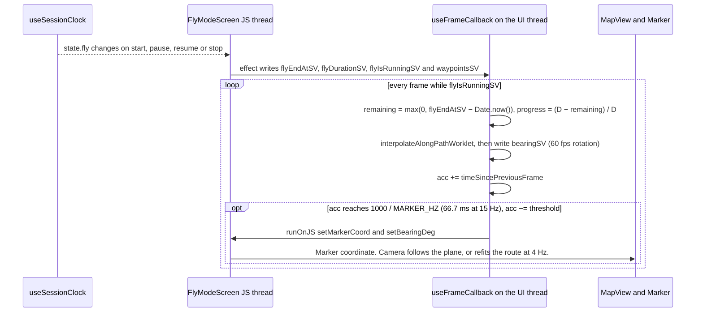

- Code: `FlyModeScreen.tsx:131,262–267,321–370,533–566`.
- **The progress formula** is $p = \mathrm{clamp}\big((D - R)/D,\,0,\,1\big)$, with $R = \max(0, E - \text{Date.now()})$. It uses the same `Date.now()` basis as the clock and the notification, so the plane lands within a frame of `onComplete` ([plane-clock doc](../implementations/2026-04-20-plane-clock-driven.md) §4).
- **The accumulator subtracts the threshold** instead of resetting to zero, which bounds cadence drift to one frame.
- **While paused** the callback returns early. A cold-start paused restore writes `bearingSV` directly (`:303–316`).
- **In the background** nothing changes the fly SharedValues: their only writer is the fly-slot effect (`:321–331`). The callback simply doesn't run while iOS suspends the UI, and on return it recomputes from `Date.now()`. (`scale-plan.md:16` says `flyIsRunningSV` is set to false on backgrounding; no code does that.)
- **Rotation** is `bearingSV − mapHeadingSV`, applied by an animated style (`:291–293`).

### 6.5 The lazy Fly load (B1)

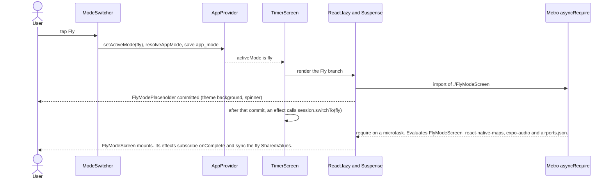

- Code: `TimerScreen.tsx:25–39,86–95,346–357`.
- **Effect:** 56 modules leave cold-start evaluation, 1,799 → 1,745 on iOS ([B1 doc](../implementations/2026-10-29-phase1-b1-lazy-fly-mode.md) §4). The bytecode size is unchanged, because Hermes ships one bundle.
- **On Android and web,** `resolveAppMode` turns `fly` into `default`, so the module is never evaluated. `flyLazyLoad.test.tsx` checks this.

---

## 7. Deployment

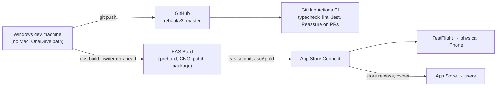

**EAS profiles** (`eas.json`):

| Profile | Settings | Use |
|---------|----------|-----|
| `development` | `developmentClient: true`, internal distribution (`:7–10`) | A dev client; not used so far |
| `preview` | internal distribution (`:11–13`) | Android release-variant APKs (R8 on) for the emulator |
| `preview-simulator` | extends `preview`, `ios.simulator: true` (`:17–22`) | An iOS compile check with no device credentials |
| `production` | `autoIncrement: true` (`:14–16`) | Store and TestFlight builds |
| submit `production` | `ios.ascAppId: "6757491918"` (`:24–30`) | Unattended TestFlight submission |

**Version sources:**

- The marketing version is `app.json:5` `"1.4.0"`, and `package.json:3` matches it.
- The CLI uses `"appVersionSource": "remote"` (`eas.json:4`), so **EAS owns the build numbers** and bumps them on every production build. That makes `app.json`'s `ios.buildNumber: "6"` (`:16`) and `android.versionCode: 2` (`:23`) inert. The TestFlight build is 42 (tag `v1.4.0-tf.42`).
- Releases are tagged at the commit of each version's last finished EAS build ([documentation-system record](../implementations/2026-10-30-documentation-system.md) §4.1).

**CNG and native configuration.** Prebuild generates the native projects from `app.json`'s plugins (`:32–100`):

- `expo-build-properties` sets iOS `useFrameworks: "static"` and the Android R8 keep rules for Room and WorkManager.
- `react-native-google-mobile-ads` sets the AdMob app ids and 33 SKAdNetwork ids.
- `expo-splash-screen`, `expo-notifications`, `expo-asset`, `@react-native-community/datetimepicker`, `expo-font` and `expo-audio` do their own native setup.
- `postinstall: patch-package` (`package.json:10`) applies the AIRMap patch on every install, EAS included. `ITSAppUsesNonExemptEncryption: false` (`:18`) skips the export-compliance prompt.

**No OTA updates yet.** `package.json` has no `expo-updates`, and `app.json` has no `updates` or `runtimeVersion` key. Every JS change ships as a store build. The only update mechanism users see is the store-version prompt (§3). EAS Update is in plan §4.1 with no phase assigned (§12).

**Operational facts.** The iOS distribution certificate expires on **2027-01-07** ([Phase 1 plan](../implementations/2026-10-29-phase1-plan.md) A0). CI is a quality gate, not a deploy pipeline: builds and submissions are manual and need the owner's go-ahead.

---

## 8. Cross-cutting concepts

### 8.1 The re-render chain, and its trap

**How the timer text updates today.** This is the mechanism documented in `useSessionClock.ts:63–65,163–164` and in [rehaul plan](../implementations/2026-10-29-couples-rehaul-plan.md) §1.2 (F1) and §4.5:

1. While the active slot runs, the 1 Hz interval calls `setDisplayTick(t => t + 1)` (`useSessionClock.ts:164`).
2. That state update re-renders **`AppProvider`**, which hosts the hook.
3. On that render, every hosted hook returns a **new object literal**: `useSessionClock.ts:303–308`, `useStats.ts:302–319`, `useSettings.ts:66–70`, `useLoveNotes.ts:102–111` and `useReminder.ts:186–193`. So the `useMemo` dependencies at `AppContext.tsx:46–50` change, and the context value gets a new identity.
4. **Every context consumer re-renders:**
   - the six `useApp()` call sites: `TimerScreen.tsx:44`, `FlyModeScreen.tsx:143`, `StatsScreen.tsx:34`, `SettingsScreen.tsx:32`, `LoveNotesScreen.tsx:25` and `useTheme.ts:12`
   - through `useTheme`, every themed component: `App.tsx:40` (`ThemedApp`, the root, which rebuilds the `linking` object and the `Navigation` element at `:71–83`), `AirportPicker`, `FlyTimerPill`, `GoalReachedPopup`, `LoveNoteCard`, `ModeSwitcher` and `PremiumCalmBackground`
   - this includes tabs that are mounted but hidden
5. During those renders, `displayMs` (`useSessionClock.ts:297–301`), `useTimer`'s `remainingMs` (`useTimer.ts:243–249`) and Fly's `displayMs` (`FlyModeScreen.tsx:187–191`) read `Date.now()` again, **and that is the only reason the visible text changes.**

**The trap.** The waste and the timer display are the same chain. Any `React.memo`, stable context value or selector placed between `AppProvider` and the timer text, without its own time subscription, freezes the timer **silently**. Nothing throws.

The fix is planned for B4 and only lands behind its guards: a `clockStore` (`useSyncExternalStore`) that only a `<TimerText>` leaf subscribes to, SharedValue-driven rings, and then the removal of `setDisplayTick` (§12).

> **Correction to [`scale-plan.md`](../scale-plan.md).** Its line 12 says the counter lives "inside the `AppContext.Provider` value". It doesn't: the counter is state that nobody reads (`useSessionClock.ts:65`). The value's identity changes because of step 3 above.

**The guards:**

| Test | What it proves |
|------|----------------|
| `src/context/__tests__/timerTextTicks.test.tsx` | A probe inside `AppProvider` shows 25:00 → 24:59 → 24:00 under fake timers |
| `src/screens/__tests__/timerScreenTicks.test.tsx` | The **real** `TimerScreen` does the same in Classic (`:69–80`) and in Fly, on IST → LUZ, a 25-minute flight (`:82–107`) |
| `src/context/__tests__/rerenders.perf-test.tsx`, `src/screens/__tests__/screens.perf-test.tsx` | Reassure render counts during a 10 s session: 14 for a settings-only consumer and for each screen except Settings, which has 15 (NFR-PERF-003) |

- The tick tests cover FR-TMR-006. They were **mutation-checked**: with `setDisplayTick` deleted, all three tick tests fail at 24:59 ([Stage A doc](../implementations/2026-10-29-phase1-stage-a.md) §3.1). Before that, `timerTextTicks` alone had been mutation-checked again after the SDK 58 step (upgrade doc §3.2).
- Reassure runs only through `npx reassure`. Jest's `testMatch` picks up `*.test.*` files only (`package.json:73–75`). CI runs Reassure on pull requests only, and it is informational (`ci.yml:35–61`).

### 8.2 Persistence

Every value lives in AsyncStorage as JSON text, one key per concern. `storage.ts` saves (logging and rethrowing on failure) and loads (default on a missing key or corrupt JSON). Key names carry their version (`stats_v2`, `reminder_v1`, `ad_policy_v1`); there is no migration framework yet (B2).

| Key | Constant | Shape (type) | Owner: read / write | Notes |
|-----|----------|--------------|---------------------|-------|
| `timer_state` | `TIMER_STATE` | `PomodoroState` (`useTimer.ts:14–18`) | `useTimer` `:66–70` / `:58` | Older installs may also hold v1.0 clock fields; the reader ignores them |
| `settings` | `SETTINGS` | `Settings` (`types/index.ts:42–56`) | `useSettings` `:25` / `:14,58` | Deep-merged over `DEFAULT_SETTINGS` |
| `stats` | `STATS` | `StatsMap` | `useStats` `:113` / never | The v1 map; read once to migrate, never deleted |
| `stats_v2` | `STATS_V2` | `StatsState` | `useStats` `:110` / `:86` | `lastAppliedSessionId` is dropped on load (R2) |
| `gift_mode` | `GIFT_MODE` | `GiftMode` | `useGiftMode` `:14` / `:29` | |
| `love_notes` | `LOVE_NOTES` | `string[]` (the type declares `LoveNotes { notes }`) | `useLoveNotes` `:29` / `:18` | Missing or empty → the default notes |
| `update_meta` | `UPDATE_META` | `LegacyUpdateMeta` (fixture) | **none at HEAD** | Written by 1.0.2–1.3.0; orphaned |
| `reminder_v1` | `REMINDER_V1` | `ReminderSettings` | `useReminder` `:44` / `:29` | Holds the scheduled `notificationId` |
| `app_mode` | `APP_MODE` | `AppMode` | `AppProvider` `:36` / `:42` | Passed through `resolveAppMode` on read and on write |
| `fly_session` | `FLY_SESSION` | `LegacyFlySession` (fixture) | **none at HEAD** | Deprecated since the unified clock; orphaned |
| `session_clock` | `SESSION_CLOCK` | `SessionClockState` | `useSessionClock` `:127` / `:100` | Written on every commit, so every action |
| `fly_prefs` | `FLY_PREFS` | `{ cameraMode, isGlobe }`, inline (`FlyPrefs` in the fixture) | `FlyModeScreen` `:232` / `:242` | An invalid `cameraMode` falls back to `followPlane` |
| `ad_policy_v1` | none (`AdPolicy.ts:3`) | `AdState` | `AdPolicy` `:30` / `:90` | **Bypasses `storage.ts`** |
| `startup_variant_v1` | `STARTUP_VARIANT_KEY` (`src/startup/startupVariant.ts`) | `{ mode: 'deferred' \| 'eager' \| 'alternate', last: 'deferred' \| 'eager' \| null }` | `startupVariant` / the hidden panel, and `alternate` launches | Diagnostics (B7). Written only once the panel has been opened |
| `startup_probe_v1` | `STARTUP_PROBE_KEY` (`src/startup/startupProbe.ts`) | `ProbeRow[]`, newest 40 | `startupProbe` | Diagnostics (B7). Written only once the panel has been opened; leaves the phone only through the panel's Share |

- The keys are listed in `src/utils/storage.ts:48–61`, except `ad_policy_v1`.
- `src/__fixtures__/storage/v131.ts` freezes every shape, typed against the readers, so `tsc` fails if one drifts (FR-MIG-001).
- **A stale doc.** The [timer-unification doc](../implementations/2026-04-19-timer-unification.md) §4 says `fly_prefs` falls back to `{ cameraMode: 'seeAll' }`. The code falls back to `{}`, then `followPlane`, and also stores `isGlobe` (`FlyModeScreen.tsx:231–243`). `seeAll` is no longer a valid mode.

### 8.3 Theming

- **Two palettes** (§5.9) serve the system, light and dark modes. Fly uses `ValentineSpec` whatever the mode. No contrast checking exists yet (C1, NFR-A11Y-001).
- **What follows `isDark`:** React Navigation's `DarkTheme` or `DefaultTheme` (`App.tsx:67`), the status-bar style (`TimerScreen.tsx:344`) and the MapKit `userInterfaceStyle` (`FlyModeScreen.tsx:713`).

### 8.4 Haptics

All haptics go through `expo-haptics`, and every call catches its own failure (web, unsupported hardware).

- **Gated by `settings.haptics`:** selection on the primary button (`TimerScreen.tsx:203–205`); success on completion (`useTimer.ts:126–128`, `FlyModeScreen.tsx:386–388`); selection on the camera and globe toggles and on sheet snaps (`FlyModeScreen.tsx:605,610`; `FlySheet.tsx:117`).
- **Not gated:** `HapticTab` fires a light impact on every iOS tab press, whatever the setting (`HapticTab.tsx:10–13`, R11).

### 8.5 Accessibility

What exists at HEAD:

- **Reduce Motion** is honoured only by `PremiumCalmBackground`, through `AccessibilityInfo.isReduceMotionEnabled` and its change listener (`:79,96–97,107,228`). The goal popup and note card follow the app's own "background animations" toggle instead.
- **Accessibility roles and labels** are on the mode switcher, the airport picker buttons, the Fly map controls and the lazy placeholder: 4 `accessibilityRole`s and 6 `accessibilityLabel`s in all of `src/`. The Classic Start, Skip and Reset buttons have text but no role.
- **Dynamic Type** isn't blocked (no `allowFontScaling={false}`), and it has never been tested.

The targets are NFR-A11Y-001 to NFR-A11Y-004.

### 8.6 The platform split

There is **one gate**: `isFlyModeAvailable()`, true only on iOS (`features.ts:11–13`).

- **Why only iOS:** Android needs a Google Maps key the app doesn't ship, and react-native-maps has no web implementation.
- **Stored modes:** `resolveAppMode` maps a stored or requested `fly` to `default` elsewhere (`:20–22`). That stops the 2026-10-29 Android crash loop. Covered by `features.test.ts` and `flyModeGuard.test.tsx`.
- **The UI:** the switcher is hidden where Fly is unavailable (`TimerScreen.tsx:376–378`), and the lazy module is never evaluated there.
- **Other forks:** `Platform.OS === 'web'` in Reset (`window.confirm`) and the reminder (disabled); the Android notification channels; the update-check source (§3); and `.ios.tsx` files for the icons and the tab blur.

### 8.7 Error handling and logging

- **Degrade, never block.** Storage reads fall back to defaults, and writes are fire-and-forget (`.catch(() => {})` or a logged chain), so a failed write is never shown. A notification-scheduling failure is logged and the session starts without an alert. Every ad and update-check failure is swallowed.
- **No crash reporting** yet; Sentry is planned for Phase 2 (NFR-REL-001).
- **Logging** is `console.*`. Most debug logs are `__DEV__`-gated, but `console.error` in `storage.ts` and in the hooks' save chains also runs in release builds. Reanimated logs worklet warnings without strict mode (`App.tsx:5`).

### 8.8 Testing seams

`jest.setup.ts` stubs each native module at its package boundary, and each stub carries a comment explaining why: Gesture Handler's own setup (`:11`), AsyncStorage (`:13–15`), worklets (`:18`), **a narrow stub for a Reanimated 4.7.1 bug** (`setCSSEventHandler`, `:22–25`, to remove when upstream fixes it), Reanimated (`:26`), safe-area (`:28`), `react-native-maps` as plain `View`s with no-op camera methods (`:34–49`), `expo-audio` (`:54–57`) and AdMob (`:61–75`).

- `babel.config.js` adds `@babel/plugin-transform-dynamic-import` for `NODE_ENV=test` only, so `React.lazy(() => import())` runs in Jest. App builds get Expo's default config.
- `jest.babelTransformer.js` (Phase 1 B5) is jest-expo's transform, plus the React Compiler for app code exactly when `app.json` turns it on, as Metro does; tests, fixtures, mocks and `jest.setup.ts` stay uncompiled ([ADR-0041](adr/0041-react-compiler-on.md)). `src/components/__tests__/reactCompiler.test.tsx` pins it.
- Fake timers also fake `Date.now()`, so the clock maths and the interval move together.
- At HEAD: 44 tests in 10 suites, plus 6 Reassure scenarios ([B1 doc](../implementations/2026-10-29-phase1-b1-lazy-fly-mode.md) §6).
- Strategy and gates: [test strategy](../testing/TEST-STRATEGY.md), in particular [§3](../testing/TEST-STRATEGY.md#3-test-seams-and-mocks) and [§4](../testing/TEST-STRATEGY.md#4-the-guards-that-protect-the-riskiest-code).

---

## 9. Architecture decisions

The decisions are recorded as ADRs in [`adr/README.md`](adr/README.md), the ADR index, which is being written in parallel. The main ones: the end-timestamp clock; the two-slot clock and its v2 replacement by one server-owned engine; CNG, with one SDK upgrade at a time; AdMob held on 16; the React Compiler lint rules at `warn` until B5, then the compiler on with them at `error`; lazy Fly Mode, then the airports asset; MMKV, Zustand and Expo Router; Supabase with server-owned time; and iOS first. The index numbers them; this document doesn't.

---

## 10. Quality

The measurable quality requirements are the SRS non-functional requirements, [SRS §3.3](../srs/SRS.md#33-non-functional-requirements). This architecture is most exposed to NFR-PERF-002 (the bytecode below the SDK 58 baseline of 3,856,208 B on iOS; B1b), NFR-PERF-003 (the render-count drop; B4), NFR-REL-002 (no data loss), NFR-REL-003 (green CI gates on every store build) and NFR-PORT-001 (hide, never crash). How each is verified is in the [test strategy](../testing/TEST-STRATEGY.md).

---

## 11. Risks and technical debt

### 11.1 Findings F1–F11 of the rehaul plan (§1.2), status at `5b10a78`

| # | Finding | Status | Evidence |
|---|---------|--------|----------|
| F1 | The whole app re-renders at 1 Hz while a timer runs | **Fixed** in B3 (components that show no time) and B4 (the screens: only `<TimerText>` commits each second), 2026-10-30, pushed; device check passed (TestFlight build 45) | §8.1; [B4 record](../implementations/2026-10-30-phase1-b4-rerender-refactor.md) |
| F2 | `airports.json` and the map stack are in the startup path | **Partly fixed.** Evaluation is deferred (B1, `5b10a78`: 56 modules). The JSON is still in the bytecode, and B1b is in progress (§1.3). | `TimerScreen.tsx:25`; `FlyModeScreen.tsx:46` |
| F3 | Android ads earn nothing | **Open**, deferred with Android (AN5) and Phase 5 | `app.json:50,106,108` |
| F4 | `master` isn't trunk | **Fixed** in Phase 0 (`fda4fef`) | Phase 0 doc §3.1 |
| F5 | Version drift | **Fixed** (`f4c25db`, then `a12ced4`: 1.4.0 in both). The build numbers in `app.json` are inert (§7). | `package.json:3`; `app.json:5` |
| F6 | No tests, CI or lint gate | **Fixed** in Phase 0 (Jest, RNTL, Reassure; CI in `9a24a62`) | `ci.yml` |
| F7 | No device check done | **Partly fixed.** A0 passed on a physical iPhone (TestFlight build 42, 2026-10-29). `docs/device-check-backlog.md` still has 0 of 61 boxes ticked. | Upgrade doc §6.3 |
| F8 | Template leftovers, unused packages | **Fixed** (`b79085a`) | Phase 0 doc §3.4 |
| F9 | The README's "No server connections" claim | **Open at HEAD** (`README.md:195`). A rewrite is in the working copy; the real policy is Phase 2 (NFR-PRIV-002). | §3 |
| F10 | Emoji as icons, aurora gradients, the blur tab bar | **Open** (Stage C/D, NFR-UX-002) | `tokens.ts:17–22,36–41`; `TabBarBackground.ios.tsx`; `ModeSwitcher.tsx:13`; `FlyModeScreen.tsx:114–118` |
| F11 | `_TEMPLATE.md` missing | **Fixed** | `docs/implementations/_TEMPLATE.md` |

### 11.2 Further risks and debt

| # | Risk or debt | Evidence | Mitigation or owner |
|---|--------------|----------|---------------------|
| R1 | **Fly credits bypass both the idempotency key and start-day attribution.** `stats.incrementFocus(minutes)` gets no `dayKey` and no `sessionId`, so a flight is credited to the completion day and isn't deduplicated at the stats layer. Pomodoro passes both. This contradicts FR-STA-001 and FR-STA-002 for Fly. | `FlyModeScreen.tsx:390–393` against `useTimer.ts:108–113` | **Fixed in B3** (`7863e50`, DEF-001). Was: pass `slot.sessionStartedAt` and `slot.sessionId`, with a test (Phase 1, or the Phase 3 engine) |
| R2 | **`lastAppliedSessionId` doesn't survive a restart.** The load builds a new state without it (`useStats.ts:124–128,137–141`), and it is only set again at `:240`. The key does its job within one process; across a kill, only the clock's `endAt` guard protects against double credit. | `useStats.ts` | **Fixed in B3** (`71d836f`, DEF-002). A credit table in Phase 3 makes it a constraint |
| R3 | **A goal hit after midnight can reset the streak.** "Yesterday" is computed from `new Date()` (`:212–217`), while the credited day is the start day (`:172`). A focus session that starts at 23:50 and completes at 00:15 credits day *D−1*, but checks *D−1* itself as "yesterday". If that session reaches the goal, `current` becomes 1 even when *D−2* was a hit day. | `useStats.ts:172,210–226` | **Fixed in B3** (`7863e50`, DEF-003). Was: Derive "yesterday" from `targetDayKey`, with a test |
| R4 | **The Stats banner ad is outside `AdPolicy`** and isn't in the docs. Plan §1.1 and `PRODUCT.md` describe interstitials only. The banner shows whenever Stats is open, including during a running session, which `PRODUCT.md` principle 5 rules out for v2. | `StatsScreen.tsx:4,297–301` | An owner decision for D1 or Phase 5 |
| R5 | **A cold-start Fly completion probably goes uncredited** (§6.2). This comes from reading the code and hasn't been tested on a device. It contradicts FR-TMR-005 for Fly. | `useSessionClock.ts:127,134–139`; `AppContext.tsx:35–37`; `TimerScreen.tsx:346–353` | **Fixed in B3** (`e04cc8c`, DEF-004): completions wait for a handler of their kind. The test showed it is wider than read here: Pomodoro too, every time since B2, because the navigator mounts the screens after `Linking.getInitialURL()` |
| R6 | **An orphan notification when scheduling is slow.** The 1 s `Promise.race` drops a late id, while the notification is still scheduled, so pause or skip can't cancel it. | `useTimer.ts:163–166,203–206`; `FlyModeScreen.tsx:416–419,468–471` | Store the id when the schedule resolves, or cancel late ids |
| R7 | **The AIRMap native patch** must be re-cut on every react-native-maps upgrade. Upstream 1.29.11 has the insert nil and bounds guard (`AIRMap.mm:160–163` in `node_modules`); the patch adds only the remove nil guard. The JS `mapReady` gate and the rule against `null` MapView children stay. | `patches/react-native-maps+1.29.11.patch`; `FlyModeScreen.tsx:207,744,786–790`; [AIRMap fix](../implementations/2026-05-05-airmap-insert-subview-crash-fix.md) | Drop the patch when upstream guards the remove path; the real map becomes Plus-only in Phase 4c |
| R8 | **The Reanimated 4.7.1 Jest stub** hides one upstream bug | `jest.setup.ts:19–25` | Re-check on every Reanimated upgrade |
| R9 | **`@expo/config-plugins` is declared as a devDependency** because SDK 56 stopped hoisting it, and the datetimepicker and AdMob 16 plugins `require` it. expo-doctor flags it, and the flag is accepted. | `package.json:53`; upgrade doc §3.2 | Remove when those plugins move to `expo/config-plugins` (AdMob 17 in Phase 5) |
| R10 | **OneDrive placeholders.** OneDrive turned 9 root files into cloud reparse points, which SDK 56's Node watcher drops, so Metro "can't find `index.tsx`". Fixed locally once; it can recur at any time. EAS and CI are unaffected. | Upgrade doc §5 finding 2 | Move the repo out of OneDrive (owner) |
| R11 | Tab haptics ignore the `haptics` setting | `HapticTab.tsx:10–13` | D2 |
| R12 | The `sound` setting is persisted but does nothing, because no completion sound exists (`DECISIONS.md` Q1) | `SettingsScreen.tsx:267–268`; `useNotifications.ts:36` | D4 (SoundCraft) |
| R13 | Dead or unused API: the clock's five active-slot SharedValues have no reader, and `extend()` has no caller | `useSessionClock.ts:38–42,264–280` | B4 rewrites the clock surface |
| R14 | `updateSettings` saves inside the state updater and skips the serialising chain | `useSettings.ts:47–64` | B3 |
| R15 | **The update prompt on non-iOS reads a stale `update.json`** (live 1.0.2), and its copy always says "App Store". The URL is duplicated in `App.tsx:23` and `SettingsScreen.tsx:24`. | §3; `useUpdateCheck.ts:102–104` | The Pages move is an owner decision ([documentation-system record](../implementations/2026-10-30-documentation-system.md) §5) |
| R16 | ~~The React Compiler lint rules are at `warn` (105 findings)~~ **Closed in B5** (`7a849b3`): the 94 findings left are fixed or, in two Fly cases, suppressed with a reason; the rules are at `error` and the compiler is on ([ADR-0041](adr/0041-react-compiler-on.md)). What it still skips: `node scripts/react-compiler-report.js` | `eslint.config.js` | Done |
| R17 | The distribution certificate expires on 2027-01-07 | Phase 1 plan A0 | Owner renews it before any later submission |

---

## 12. Target v2 architecture

The [rehaul plan](../implementations/2026-10-29-couples-rehaul-plan.md) §4 holds the full design. In short:

- **The stack.** Expo Router replaces the static React Navigation config. Zustand stores with selectors replace the one context. TanStack Query, persisted to MMKV, holds server state. MMKV replaces AsyncStorage.
- **The backend.** Supabase: Postgres, Auth, Realtime, Edge Functions, Storage and pg_cron. RevenueCat handles the couple entitlement. Sentry and EN/TR i18n arrive too.
- **Modes become skins** over one engine; a mode never has its own clock.
- **The rule: the server owns time.** Every command runs in SQL with `now()`, and clients only display time, corrected by an NTP-style clock offset $\hat\theta = s - (t_0 + t_1)/2$, taken as the best of 5 samples (plan §8.1).
- **Commands** are idempotent and use optimistic concurrency on `version` (plan §8.2).
- **Completion and credit.** Shared sessions complete through a pg_cron worker that sends server pushes. Credits are rows that are unique per `(session_id, user_id)`. Solo sessions keep today's local path: a local notification and on-device credit.

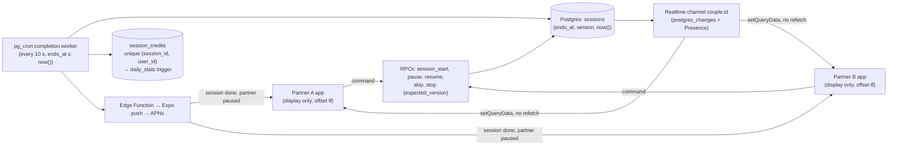

Timer ticks never cross the network; only state changes do, about 6 messages per session.

The re-render fix is plan §4.5: the clock store, UI-thread rings, store selectors, `freezeOnBlur` and the React Compiler. The target is one `<TimerText>` commit per second instead of every consumer.

**Transition from HEAD:**

| When | Change | What it replaces at HEAD | Status |
|------|--------|--------------------------|--------|
| Phase 1 B1 | `FlyModeScreen` behind `React.lazy` | The static import in `TimerScreen` | **Done** (`5b10a78`) |
| Phase 1 B1b | `airports.json` becomes an asset read through `expo-asset` and `expo-file-system`, parsed when Fly first opens | The JSON module in the bytecode (`FlyModeScreen.tsx:46`) | **Done** (`0d63145`) |
| Phase 1 B2 | MMKV, with a one-time migration of every AsyncStorage key; the flag is written last, and AsyncStorage is kept for one release | `storage.ts`, and `AdPolicy`'s direct AsyncStorage use | **Done** (`dd1e894`) |
| Phase 1 B3 | Zustand stores (settings, notes, stats, session/clock, UI), hydrated synchronously; `AppContext` becomes a shim, then is deleted | `AppProvider` and the five hosted hooks | **Done** (`71d836f`…`e04cc8c`), pushed; device check passed on TestFlight build 44 |
| Phase 1 B4 (gated) | `clockStore` with `useSyncExternalStore`, and only `<TimerText>` subscribes; rings driven from `endAt` by SharedValues; `setDisplayTick` removed; `freezeOnBlur` | The re-render chain (§8.1); the React-rendered `CircularProgress` | **Done** (`b7461f1`…`b838ebe`), pushed; guards green and mutation-checked; device check passed (TestFlight build 45) |
| Phase 1 B5 | The React Compiler on; the lint rules back to `error`; Jest compiles app code as Metro does (`jest.babelTransformer.js`) | The rules at `warn` (`eslint.config.js`); uncompiled components | **Done** (`10811ce`…`6395aee`), pushed; device check passed (TestFlight build 45) |
| Phase 1 B6 | Expo Router: `app/(tabs)/index`, `stats`, `settings`, `notes`, `+not-found`; the iOS native tab bar; hidden tabs frozen by `FreezeOnBlur`; the scheme is kept | `src/navigation/` | **Done**, merged as `1b7a8d7` (`a736b22`…`62fef2e`); device check passed on `v1.4.0-tf.46` |
| Phase 1 B7 | `AdManager.init` and the launch update check run after the first frame (`src/startup/`); audio had no cold-start work left after B1 | The mount-effect calls in `ThemedApp` | **Done**, merged as `3d3fbaf` (`6ab3953`…`e0e8f26`); device check passed on `v1.4.0-tf.46`; TTI numbers to be recorded |
| Phase 1 C–E | Tokens and the contrast script; the display face; VectorCraft icons and mascots; Classic rebuilt with presets; emoji → icons; EN/TR; SoundCraft sounds; on-device migration check | `tokens.ts`, emoji labels, the default notes, the missing sound | Not started |
| Phase 2 | Supabase schema, RLS and pgTAP; anonymous auth, then Apple, Google or email; account deletion and export; local-to-cloud upload; invites and the website `/invite`; Sentry and `events`; TanStack Query | "Local only"; the README claim | Planned |
| Phase 3 | The shared session engine: RPCs, the completion worker, pushes, credits, clock offset, presence, the offline queue, cheers, partner notes, the couple streak | The two-slot `useSessionClock` and on-device-only credit | Planned |
| Phase 4 | Modes. 4a Garden. **4b Fly Together on an illustrated SVG map** with a curated city list. 4c the real map as a phone-only Plus extra behind a flag, with `useCameraController`. 4d Room. 4e Pet. | The real map as the default; the 648 KB dataset on the default path | Planned |
| Phase 5 | RevenueCat and entitlements; the paywall; AdMob 17 with UMP consent, real Android ids and the gating rule (plan §8.7) | AdMob 16; Android test ids; `AdPolicy`'s two terms | Planned |
| Phase 6 | The Expo web build, Web Push, Cloudflare Pages, Lighthouse CI | — | Planned |
| Phase 7 | Hardening, Maestro E2E, the load test, rebranding, widgets and Live Activity | — | Planned |
| Android track AN0–AN6 | The Play closed test, a Maps key, camera parity, layout fixes, real ids, release | `isFlyModeAvailable` = iOS only | Deferred |
| Unassigned | **EAS Update** for JS-only fixes (plan §4.1). No phase in the plans or the roadmap. | Store builds only (§7) | TBD (owner) |

---

## 13. Glossary

| Term | Meaning |
|------|---------|
| **A0–A3, B1–B7, C1–C4, D1–D4, E1–E4** | Phase 1 tasks ([Phase 1 plan](../implementations/2026-10-29-phase1-plan.md) §3) |
| **`activeKind`** | Which clock slot (`pomodoro` or `fly`) drives `displayMs`; `null` when idle |
| **AIRMap** | react-native-maps' iOS map view class; the source of the `insertReactSubview` crashes |
| **CNG** | Continuous Native Generation: native projects generated from `app.json` at build time, never committed |
| **Cold start** | Launching after the process was killed. The clock's load runs the completion check. |
| **`displayMs`** | Remaining ms of the active slot, computed at render |
| **EAS** | Expo Application Services: Build, Submit (and Update, not used) |
| **`endAt`** | The epoch ms (`Date.now()` basis) at which a running slot completes; the source of truth for time |
| **Fabric** | React Native's New Architecture renderer |
| **Fly Mode / Fly Together** | Today's real-map flight timer / v2's couple version on an illustrated map |
| **Guard** | A test that must stay green through a refactor, and that was seen to fail when the protected code was broken (mutation-checked) |
| **Hermes** | The JS engine; it ships one precompiled bytecode bundle per platform |
| **`MARKER_HZ`** | The cadence (15) at which the plane worklet bridges the marker position to JS |
| **MMKV** | A synchronous key-value store; replaces AsyncStorage in B2 |
| **Plus** | v2's couple subscription |
| **Reassure** | A render-count and timing regression tool; the baseline is in the Stage A doc |
| **RNTL** | React Native Testing Library |
| **SharedValue** | A Reanimated value readable on the UI thread without a React render |
| **Slot** | One `SessionSlot` in the clock: running, paused or empty |
| **`setDisplayTick`** | The 1 Hz state bump that re-renders `AppProvider`, and so the timer text (§8.1) |
| **TestFlight** | Apple's beta channel; the only way this project runs on a real iPhone |
| **Worklet** | A function compiled to run on the UI thread (`'worklet'` directive) |

## Backlinks
<!-- backlinks:start -->
- [Changelog](../../CHANGELOG.md)
- [Valentine Pomodoro](../../README.md)
- [Documentation map](../README.md)
- [Software Requirements Specification — Valentine Pomodoro v2 (couples rehaul)](../srs/SRS.md)
- [Requirements traceability (generated)](../testing/TRACEABILITY.md)
<!-- backlinks:end -->
